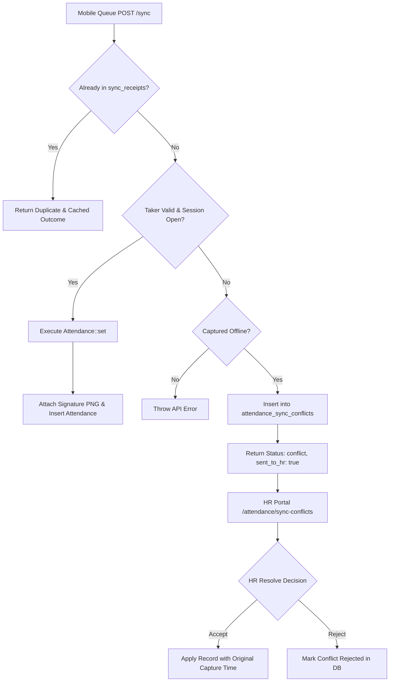

# COMPREHENSIVE PROGRAMS ATTENDANCE SYSTEM INSPECTION & VALIDATION REPORT
**Project:** Mezmur Zemseretee Hiwot (Mobile Application & Laravel 11 Backend)  
**Audit Type:** Validated Read-Only Technical Inspection & Codebase Audit  
**Scope:** Full Attendance System & Non-Education Programs Attendance Workflow  
**Date of Validation:** October 2026  
**Document Status:** Validated Final Audit Deliverable  

---

## 1. Executive Summary

This report delivers the validated, evidence-based technical inspection of the non-Education attendance subsystem across the Mezmur Zemseretee Hiwot repository. The inspection covers the Laravel 11 backend, MariaDB/MySQL database schemas, REST APIs, middleware authorization layers, background synchronization engines, mobile Flutter screens, SQLite offline storage, and automated test suites.

### Strict Scope Boundary
This inspection strictly encompasses Programs attendance, shared attendance services, recurrence and scheduling, absence permissions, offline synchronization, and reporting/export pipelines. **All Education-module attendance screens, services, models, and workflows are strictly excluded from this report** in accordance with project audit boundaries.

### Summary of Corrections & Additions Made to the Initial Report
1. **Standardized Verification Classifications:** All 22 program attendance capabilities have been re-classified strictly into the six standard verification categories: `Runtime verified`, `Code verified, runtime unverified`, `Partially implemented`, `Confirmed defect`, `Not implemented`, and `Unresolved`.
2. **Accurate Test Execution Distinction:** Clarified that while Flutter mobile test suites executed and passed completely in the runtime environment (34/34 assertions), Laravel backend integration tests skipped execution because the local environment does not currently host an active MariaDB/MySQL `mh_app_test` service instance.
3. **Deep Investigation of the Three Architectural Findings:** 
   - *F-01 (Participant Group Changes):* Confirmed as an architectural limitation of single-column mutable group assignments (`users.member_group`) impacting historical rosters.
   - *F-02 (Virtual Absences):* Confirmed as an intentional, highly efficient sparse-storage design choice rather than a defect.
   - *F-03 (Session Expiration):* Confirmed as a lazy-evaluation pattern executed on read rather than a polling cron job.
4. **Occurrence Status Clarification:** Clarified that the system does not implement distinct "suspended" or "skipped" states for Programs occurrences; skipping is handled via `action = 'cancelled'`, while unheld unclosed occurrences expire into absence dynamically.
5. **Concrete File References & Line Numbers:** Added line-level code citations across all domain services, routes, migrations, and mobile components.

---

## 2. Repository & Architecture Overview Relevant to Programs Attendance

The non-Education attendance subsystem follows a dual-tier client-server architecture with an offline-first local SQLite cache and optimistic queue synchronization.

```
┌────────────────────────────────────────────────────────────────────────┐
│                        FLUTTER MOBILE CLIENT                           │
│  - Screens: features/admin/programs_admin.dart, attendance_take.dart   │
│  - Offline DB: core/storage/local_db.dart (SQLite)                     │
│  - Sync: services/sync_service.dart, offline_pack.dart                 │
└───────────────────────────────────┬────────────────────────────────────┘
                                    │ HTTPS REST / Bearer Token / QR UUID
                                    ▼
┌────────────────────────────────────────────────────────────────────────┐
│                         LARAVEL 11 BACKEND                             │
│  - Middleware: MzAuth (Token), RequirePermission, RolePermissions      │
│  - Routes: routes/api/programs.php, personal.php, supervision.php     │
│  - Domain Services:                                                    │
│      * App\Mz\Services\AttendanceSessions (Lifecycle, Taker, Lock)     │
│      * App\Mz\Services\Attendance (Roster, Set, Bulk, Corrections)     │
│      * App\Mz\Services\Permissions (Absence Quotas & Excusal)          │
│      * App\Mz\Services\Schedule (Recurrence & Overrides)               │
│      * App\Mz\Services\Sync (Offline Queue, Clocks, Conflict Queue)    │
│      * App\Mz\Services\Reports & ReportExport (PDF/XLSX/CSV Engine)    │
│      * App\Mz\Services\Selections (Holiday Choir Attendance Scoring)   │
└───────────────────────────────────┬────────────────────────────────────┘
                                    │ Eloquent DB / PDO Transactions
                                    ▼
┌────────────────────────────────────────────────────────────────────────┐
│                     MARIADB / MYSQL DATABASE                           │
│  - Core: attendance, attendance_sessions, attendance_signatures        │
│  - Governance: attendance_sync_conflicts, attendance_corrections       │
│  - Scheduling: programs, program_attendance_takers, program_overrides  │
│  - Audit: audit_logs, sync_receipts, permission_requests               │
└────────────────────────────────────────────────────────────────────────┘
```

---

## 3. Inventory of Attendance-Related Files and Components

### Backend Implementation Files (Laravel 11)
- **`laravel/app/Mz/Services/AttendanceSessions.php`**: Manages session lifecycle (`of()`, `start()`, `end()`, `assign()`, `recordConflict()`, `conflicts()`, `resolveConflict()`, `conflictSignature()`).
- **`laravel/app/Mz/Services/Attendance.php`**: Core attendance domain logic (`roster()`, `summary()`, `identify()`, `set()`, `bulkSet()`, `remove()`, `close()`, `requestCorrection()`, `reviewCorrection()`, `statsOf()`, `memberOccurrences()`, `calendar()`, `rateSummary()`).
- **`laravel/app/Mz/Services/Schedule.php`**: Recurrence generator, date normalization, occurrence override resolution (`between()`, `on()`, `occurrenceOn()`, `loadOverrides()`).
- **`laravel/app/Mz/Services/Permissions.php`**: Absence permission engine; quotas, deadlines, and automated creation/deletion of `excused` attendance marks (`review()`, `cancel()`, `clearExcused()`).
- **`laravel/app/Mz/Services/Sync.php`**: Ingestion of offline queue operations, clock-skew adjustment, transaction safety, and routing rejected offline records to the HR conflict queue.
- **`laravel/app/Mz/Services/Reports.php`**: Program and member attendance summaries across configurable date ranges.
- **`laravel/app/Mz/Services/ReportExport.php`**: Print-ready PDF, multi-sheet XLSX, and UTF-8 CSV generators for occurrence-level and aggregate attendance reports.
- **`laravel/app/Mz/Services/Selections.php`**: Holiday choir evaluation rules based on attendance percentage and elapsed-time interval thresholds.
- **`laravel/routes/api/programs.php`**: HTTP routing for program sessions, roster querying, member identification, and taker assignment.
- **`laravel/routes/api/personal.php`**: HTTP routing for member self-attendance, absence permission management, HR sync-conflict resolution, and signature policies.
- **`laravel/routes/api/supervision.php`**: HTTP routing for attendance reporting and file exports.

### Database Migrations & Schemas
- **`laravel/database/baseline/schema.sql`**: Baseline tables (`attendance`, `attendance_closures`, `attendance_corrections`, `program_occurrence_overrides`, `program_participants`, `programs`, `program_categories`).
- **`laravel/database/migrations/2026_10_19_000001_attendance_sessions.php`**: Session governance schema (`attendance_sessions`, `attendance_signatures`, `attendance_sync_conflicts`, `program_attendance_takers`, HR permission allocations).

### Mobile Implementation Files (Flutter)
- **`mobile/mobile/lib/features/admin/programs_admin.dart`**: Administrative program attendance screen (`_ProgramAttendance`), session header (Start/End), live timer, signature capture integration, and roster filtering.
- **`mobile/mobile/lib/features/admin/attendance_take.dart`**: Camera QR scanner and manual selection sheet (`AttendanceScanScreen`, `_AttendanceVerifySheet`, `_FindMemberSheet`, `ProgramTakersSection`).
- **`mobile/mobile/lib/features/programs/program_detail_screen.dart`**: Member program attendance view and absence permission request interface.
- **`mobile/mobile/lib/services/sync_service.dart`**: Offline queue dispatcher (`SyncOp.attendanceRecord`, `SyncOp.attendanceSessionStart`, `SyncOp.attendanceSessionEnd`, `SyncOp.attendanceClear`, `SyncOp.attendanceBulk`).
- **`mobile/mobile/lib/services/offline_pack.dart`**: Local cache packaging, offline taker roster cache, and signature policy storage.

---

## 4. End-to-End Workflow Diagrams & Request Paths

### Workflow 1: Live Program Attendance Taking (Online)
```
[Taker Mobile App]               [Laravel Route]             [Attendance / Sessions]        [Database]
       │                                │                                │                       │
       │ 1. POST .../session/start      │                                │                       │
       ├───────────────────────────────►│                                │                       │
       │                                │ 2. AttendanceSessions::start() │                       │
       │                                ├───────────────────────────────►│                       │
       │                                │                                │ 3. Verify taker &     │
       │                                │                                │    window (-15m);     │
       │                                │                                │    UPDATE sessions    │
       │                                │                                ├──────────────────────►│
       │                                │◄───────────────────────────────┤                       │
       │◄───────────────────────────────┤                                │                       │
       │                                │                                │                       │
       │ 4. Scan QR / Select Member     │                                │                       │
       │    GET .../attendance/check    │                                │                       │
       ├───────────────────────────────►│                                │                       │
       │                                │ 5. Attendance::identify()      │                       │
       │                                ├───────────────────────────────►│                       │
       │                                │                                │ 6. Check active, not  │
       │                                │                                │    self, signature req│
       │                                │◄───────────────────────────────┤                       │
       │◄───────────────────────────────┤                                │                       │
       │                                │                                │                       │
       │ 7. Member signs on screen;     │                                │                       │
       │    PUT .../attendance/{userId} │                                │                       │
       ├───────────────────────────────►│                                │                       │
       │                                │ 8. Attendance::set()           │                       │
       │                                ├───────────────────────────────►│                       │
       │                                │                                │ 9. Save PNG file;     │
       │                                │                                │    INSERT attendance; │
       │                                │                                │    INSERT signature   │
       │                                │                                ├──────────────────────►│
       │                                │◄───────────────────────────────┤                       │
       │◄───────────────────────────────┤                                │                       │
```

### Workflow 2: Absence Permission Request & Administrative Approval
```
[Member App]                     [Admin App]                 [Backend API]               [Database]
      │                               │                           │                           │
      │ 1. POST /programs/{id}/       │                           │                           │
      │    permissions                │                           │                           │
      ├───────────────────────────────┼──────────────────────────►│                           │
      │                               │                           │ 2. Check quota, deadline; │
      │                               │                           │    INSERT permission_     │
      │                               │                           │    requests (pending)     │
      │                               │                           ├──────────────────────────►│
      │                               │                           │                           │
      │                               │ 3. PATCH /permissions/    │                           │
      │                               │    {id} (status: approved)│                           │
      │                               ├──────────────────────────►│                           │
      │                               │                           │ 4. Permissions::review()  │
      │                               │                           │    UPDATE request status; │
      │                               │                           │    INSERT/UPDATE          │
      │                               │                           │    attendance (excused)   │
      │                               │                           ├──────────────────────────►│
      │                               │◄──────────────────────────┤                           │
      │◄──────────────────────────────┴───────────────────────────┤ (Push Notification Sent)  │
```

### Workflow 3: Offline Capture, Replay, and HR Conflict Resolution
```
[Offline Taker]             [Sync Engine]             [AttendanceSessions]         [HR Reviewer]
      │                           │                           │                          │
      │ 1. Capture offline marks  │                           │                          │
      │    queued in SQLite       │                           │                          │
      │                           │                           │                          │
      │ 2. Connectivity restored: │                           │                          │
      │    POST /sync             │                           │                          │
      ├──────────────────────────►│                           │                          │
      │                           │ 3. Sync::recordOp()       │                          │
      │                           │    adjusted timestamp     │                          │
      │                           ├──────────────────────────►│                          │
      │                           │                           │ 4. If rejected/conflict: │
      │                           │                           │    recordConflict()      │
      │                           │                           │    (sent_to_hr = true)   │
      │                           │◄──────────────────────────┤                          │
      │◄──────────────────────────┤ (Response: conflict)      │                          │
      │                           │                           │                          │
      │                           │                           │ 5. GET /attendance/      │
      │                           │                           │    sync-conflicts        │
      │                           │                           │◄─────────────────────────┤
      │                           │                           │ 6. POST .../resolve      │
      │                           │                           │    (decision: accept)    │
      │                           │                           │◄─────────────────────────┤
      │                           │                           │ 7. Audit log & insert mark
```

---

## 5. Programs Attendance Lifecycle & State-Transition Map

```mermaid
stateDiagram-v2
    [*] --> Scheduled: Occurrence Exists (Schedule::between)
    Scheduled --> Active: Taker presses Start (POST .../session/start)\n[Within 15-min window & Before ends_at]
    Scheduled --> Cancelled: Program / Occurrence Cancelled (program_occurrence_overrides)
    Active --> Ended: Taker presses End (POST .../session/end)
    Active --> Ended: HR Closes Session (POST .../attendance/close)
    Active --> Ended: Scheduled End Reached (Lazy check: Dates::now >= ends_at)
    Active --> Cancelled: Occurrence Cancelled Mid-Session
    Ended --> [*]: Closed (Reopening strictly prohibited)
```

### State Definitions & Transition Invariants
1. **`scheduled`**:
   - Initial state. Initialized either upon query in `AttendanceSessions::of()` (`AttendanceSessions.php:48`) or when a program is scheduled.
   - Session follows default program taker (`program_attendance_takers`) unless explicitly assigned by HR.
   - Recording attendance in this state is rejected with `SESSION_NOT_STARTED` (`Attendance.php:401`).
2. **`active`**:
   - Triggered when assigned taker calls `POST /programs/{id}/attendance/session/start` (`AttendanceSessions.php:131`).
   - Permitted only within `[starts_at - 15 minutes, ends_at)`.
   - Recording attendance is permitted for expected participants.
   - Timer counts elapsed seconds from `started_at` (`Attendance.php:433`).
3. **`ended`**:
   - Final state. Transition triggered by:
     - Taker calling `POST /programs/{id}/attendance/session/end` (`end_reason = 'taker'`).
     - HR closing attendance via `POST /programs/{id}/attendance/close` (`end_reason = 'hr'`).
     - Lazy auto-transition when current time exceeds `ends_at` (`end_reason = 'scheduled_end'`) inside `AttendanceSessions::of()` (`AttendanceSessions.php:60-66`).
   - **Reopening Prohibition:** Once a session reaches `ended`, no subsequent attendance marks can be set (`ATTENDANCE_CLOSED`). Any post-closure change requires an official correction request (`attendance_corrections`).
4. **`cancelled`**:
   - Triggered when a program occurrence override (`program_occurrence_overrides`) cancels the date with `action = 'cancelled'`. Excluded from active rosters and calculations (`Schedule.php:148`).

---

## 6. Database Schema & Relationship Map

### 1. `attendance_sessions`
Tracks the execution lifecycle of a single occurrence.
- `id` (BIGINT UNSIGNED, PK, AUTO_INCREMENT)
- `program_id` (BIGINT UNSIGNED, FK -> `programs.id`, INDEX)
- `occurrence_date` (DATE)
- `taker_id` (BIGINT UNSIGNED, NULLABLE, FK -> `users.id`)
- `status` (ENUM: `'scheduled'`, `'active'`, `'ended'`, `'cancelled'`, DEFAULT `'scheduled'`)
- `started_at` (DATETIME, NULLABLE)
- `started_by` (BIGINT UNSIGNED, NULLABLE, FK -> `users.id`)
- `start_source` (ENUM: `'server'`, `'offline'`, DEFAULT `'server'`)
- `client_started_at` (DATETIME, NULLABLE)
- `client_uuid` (CHAR(36), NULLABLE)
- `ended_at` (DATETIME, NULLABLE)
- `ended_by` (BIGINT UNSIGNED, NULLABLE, FK -> `users.id`)
- `end_reason` (ENUM: `'taker'`, `'hr'`, `'scheduled_end'`, NULLABLE)
- `assigned_by` (BIGINT UNSIGNED, NULLABLE, FK -> `users.id`)
- `assigned_at` (DATETIME, NULLABLE)
- **Constraints / Indexes:**
  - `UNIQUE KEY attendance_sessions_prog_occ (program_id, occurrence_date)`

### 2. `attendance`
Stores individual member attendance marks.
- `id` (BIGINT UNSIGNED, PK, AUTO_INCREMENT)
- `program_id` (BIGINT UNSIGNED, FK -> `programs.id`, INDEX)
- `occurrence_date` (DATE, INDEX)
- `user_id` (BIGINT UNSIGNED, FK -> `users.id`, INDEX)
- `session_id` (BIGINT UNSIGNED, NULLABLE, FK -> `attendance_sessions.id`)
- `status` (ENUM: `'present'`, `'late'`, `'absent'`, `'excused'`)
- `attended_at` (DATETIME, NULLABLE)
- `elapsed_seconds` (INT UNSIGNED, NULLABLE)
- `time_source` (ENUM: `'server'`, `'device'`, `'correction'`, NULLABLE)
- `source` (ENUM: `'online'`, `'offline'`, NULLABLE)
- `via` (ENUM: `'qr'`, `'manual'`, DEFAULT `'manual'`)
- `signature_id` (BIGINT UNSIGNED, NULLABLE, INDEX)
- `signature_exempt` (TINYINT(1), DEFAULT 0)
- `client_event_id` (CHAR(36), NULLABLE, UNIQUE)
- `client_captured_at` (DATETIME, NULLABLE)
- `received_at` (DATETIME, NULLABLE)
- `notes` (VARCHAR(500), NULLABLE)
- `recorded_by` (BIGINT UNSIGNED, FK -> `users.id`)
- `updated_by` (BIGINT UNSIGNED, NULLABLE, FK -> `users.id`)
- **Constraints / Indexes:**
  - `UNIQUE KEY attendance_prog_user_occ (program_id, user_id, occurrence_date)`
  - `INDEX idx_attendance_user_occ (user_id, occurrence_date)`

### 3. `attendance_signatures`
Stores digital signatures for verified physical attendance.
- `id` (BIGINT UNSIGNED, PK, AUTO_INCREMENT)
- `attendance_id` (BIGINT UNSIGNED, FK -> `attendance.id`, INDEX)
- `user_id` (BIGINT UNSIGNED, FK -> `users.id`, INDEX)
- `path` (VARCHAR(255))
- `sha256` (CHAR(64))
- `signed_at` (DATETIME)
- `captured_by` (BIGINT UNSIGNED, FK -> `users.id`)
- `client_event_id` (CHAR(36), NULLABLE)

### 4. `attendance_sync_conflicts`
Quarantines un-applyable or disputed offline submissions for HR adjudication.
- `id` (BIGINT UNSIGNED, PK, AUTO_INCREMENT)
- `kind` (ENUM: `'record'`, `'session_start'`, `'session_end'`, `'legacy_class'`)
- `code` (VARCHAR(60))
- `program_id` (BIGINT UNSIGNED, NULLABLE)
- `class_id` (BIGINT UNSIGNED, NULLABLE)
- `occurrence_date` (DATE)
- `user_id` (BIGINT UNSIGNED, NULLABLE)
- `submitted_by` (BIGINT UNSIGNED, FK -> `users.id`)
- `client_event_id` (CHAR(36), NULLABLE, INDEX)
- `client_captured_at` (DATETIME, NULLABLE)
- `captured_at` (DATETIME, NULLABLE)
- `payload` (LONGTEXT / JSON)
- `signature_path` (VARCHAR(255), NULLABLE)
- `signature_sha256` (CHAR(64), NULLABLE)
- `status` (ENUM: `'open'`, `'accepted'`, `'rejected'`, DEFAULT `'open'`)
- `resolved_by` (BIGINT UNSIGNED, NULLABLE, FK -> `users.id`)
- `resolved_at` (DATETIME, NULLABLE)
- `resolution_note` (VARCHAR(1000), NULLABLE)
- `attendance_id` (BIGINT UNSIGNED, NULLABLE)

### 5. `attendance_corrections`
Formal audit trail for post-session record adjustments.
- `id` (BIGINT UNSIGNED, PK, AUTO_INCREMENT)
- `program_id` (BIGINT UNSIGNED, FK -> `programs.id`)
- `occurrence_date` (DATE)
- `user_id` (BIGINT UNSIGNED, FK -> `users.id`)
- `original_status` (VARCHAR(20), NULLABLE)
- `requested_status` (VARCHAR(20))
- `requested_attended_at` (DATETIME, NULLABLE)
- `reason` (VARCHAR(500))
- `requested_by` (BIGINT UNSIGNED, FK -> `users.id`)
- `status` (ENUM: `'pending'`, `'approved'`, `'rejected'`, DEFAULT `'pending'`)
- `reviewed_by` (BIGINT UNSIGNED, NULLABLE, FK -> `users.id`)
- `reviewed_at` (DATETIME, NULLABLE)
- `review_note` (VARCHAR(500), NULLABLE)
- `final_status` (VARCHAR(20), NULLABLE)

---

## 7. API Endpoint Inventory

| Endpoint Route | HTTP Method | Handler / Controller | Permission Required | Purpose |
|---|---|---|---|---|
| `/programs/attendance/takeable` | `GET` | `Attendance::takeablePrograms` | `mz` (Auth Token) | Lists programs where user is designated taker |
| `/programs/{id}/attendance` | `GET` | `Attendance::roster` | `attendance.view`, `attendance.manage`, or Taker | Retrieves occurrence roster, counts, & session status |
| `/programs/{id}/attendance/session` | `GET` | `AttendanceSessions::get` | `attendance.view` or Taker | Retrieves session lifecycle state & timing info |
| `/programs/{id}/attendance/session/start` | `POST` | `AttendanceSessions::start` | Designated Taker only | Starts live session, sets timer & `active` state |
| `/programs/{id}/attendance/session/end` | `POST` | `AttendanceSessions::end` | Taker or `attendance.close` | Concludes active session; seals marks |
| `/programs/{id}/attendance/session/taker` | `PUT` | `AttendanceSessions::assign` | `attendance.assign` | Assigns/replaces occurrence taker (reason audited) |
| `/programs/{id}/attendance-takers` | `PUT` | `Attendance::setProgramTakers` | `attendance.assign` | Updates default taker for program blueprint |
| `/programs/{id}/attendance/check` | `GET` | `Attendance::identify` | Designated Taker only | Validates participant QR/UUID and signature requirement |
| `/programs/{id}/attendance/{userId}` | `PUT` | `Attendance::set` | Designated Taker only | Records `present` (with signature) or `excused` |
| `/programs/{id}/attendance/{userId}` | `DELETE` | `Attendance::remove` | Designated Taker only | Removes mistaken mark while session is active |
| `/programs/{id}/attendance/bulk` | `POST` | `Attendance::bulkSet` | Designated Taker only | Bulk marks members `excused` (bulk present blocked) |
| `/programs/{id}/attendance/close` | `POST` | `Attendance::close` | `attendance.close` | Manually seals occurrence & marks unmarked as absent |
| `/programs/{id}/attendance/{userId}/corrections` | `POST` | `Attendance::requestCorrection` | `attendance.correction.request` | Submits formal correction request for closed occurrence |
| `/attendance/signature-policy` | `GET` / `PUT` | `Settings::signaturePolicy` | `attendance.configure` | Retrieves or configures signature exemption groups |
| `/attendance/sync-conflicts` | `GET` | `AttendanceSessions::conflicts` | `attendance.override` | Lists quarantined offline synchronization conflicts |
| `/attendance/sync-conflicts/{id}/resolve`| `POST` | `AttendanceSessions::resolveConflict` | `attendance.override` | HR accepts or rejects an offline conflict |
| `/attendance/sync-conflicts/{id}/signature`| `GET` | `AttendanceSessions::conflictSignature` | `attendance.override` | Downloads quarantined PNG signature |
| `/attendance/corrections` | `GET` | `Attendance::listCorrections` | `attendance.correction.approve` | Lists pending/reviewed correction requests |
| `/attendance/corrections/{id}/review` | `POST` | `Attendance::reviewCorrection` | `attendance.correction.approve` | Approves or rejects a correction request |
| `/attendance/me` | `GET` | `Attendance::forUser` | `mz` (Member Self) | Member's personal attendance history |
| `/attendance/me/calendar` | `GET` | `Attendance::calendar` | `mz` (Member Self) | Member's personal calendar attendance map |
| `/attendance/me/stats` | `GET` | `Attendance::stats` | `mz` (Member Self) | Member's personal attendance totals (counts only) |
| `/reports/attendance` | `GET` | `Reports::attendance` | `reports.view`, `attendance.reports` | Attendance statistics aggregated by program/occurrence |
| `/reports/export/attendance` | `GET` | `ReportExport::export` | `reports.view`, `attendance.reports` | Exports attendance to print-ready PDF, XLSX, or CSV |

---

## 8. Role & Permission Matrix

Authorization is enforced via the `mz` middleware in conjunction with explicit permissions seeded into `role_permissions`.

| Action / Capability | Member / User | Designated Taker | Department HR (`dept_hr`) | HR Manager (`hr_manager`) | IT / Admin (`dept_info`) |
|---|:---:|:---:|:---:|:---:|:---:|
| View Own Attendance (`/me`) | **Yes** | **Yes** | **Yes** | **Yes** | **Yes** |
| View Program Roster | No | **Yes** (Occurrence) | **Yes** | **Yes** | No |
| Start Attendance Session | No | **Yes** (Assigned) | No* | No* | No |
| Record Member Present | No | **Yes** (Assigned) | No* | No* | No |
| Record Own Attendance | **No** (Forbidden) | **No** (Forbidden) | **No** (Forbidden) | **No** (Forbidden) | **No** (Forbidden) |
| Remove Active Mark | No | **Yes** (With Reason)| No | No | No |
| Reassign Session Taker | No | No | **Yes** (`attendance.assign`) | **Yes** (`attendance.assign`) | No |
| End Active Session | No | **Yes** | **Yes** (`attendance.close`) | **Yes** (`attendance.close`) | No |
| Close Session (Seal) | No | No | **Yes** (`attendance.close`) | **Yes** (`attendance.close`) | No |
| Request Correction | No | **Yes** | **Yes** (`correction.request`) | **Yes** (`correction.request`) | No |
| Approve Correction | No | No | **Yes** (`correction.approve`)| **Yes** (`correction.approve`)| No |
| Resolve Offline Conflicts | No | No | **Yes** (`attendance.override`)| **Yes** (`attendance.override`)| No |
| Resolve Own Sync Conflict | **No** (Forbidden) | **No** (Forbidden) | **No** (Forbidden) | **No** (Forbidden) | **No** (Forbidden) |
| Configure Exemption Groups | No | No | **Yes** (`attendance.configure`)| **Yes** (`attendance.configure`)| No |
| View / Export Reports | No | No | **Yes** (`attendance.reports`) | **Yes** (`attendance.reports`) | No |

*\* Note: Administrators and HR Managers holding `attendance.manage` cannot directly record attendance or start sessions unless they are explicitly assigned as the session's taker.*

---

## 9. Attendance Timing & Timestamp Behavior

### Clock Synchronization & Skew Management
1. **Server vs. Device Source**:
   - Live submissions default to `time_source = 'server'`. The server clock (`Dates::now()`) provides the official capture timestamp.
   - Offline batch submissions carry `client_ts` and `client_now`. The backend calculates clock skew:  
     $$\Delta_{\text{offset}} = \text{now}_{\text{server}} - \text{now}_{\text{client}}$$  
     The effective timestamp is:  
     $$T_{\text{effective}} = T_{\text{client\_ts}} + \Delta_{\text{offset}}$$
2. **Clock Clamp Invariant**:
   - If $T_{\text{effective}} > \text{now}_{\text{server}}$, it is clamped to $\text{now}_{\text{server}}$ (`Sync.php:324`). Devices with clocks running ahead cannot inject future timestamps.
3. **Staleness Expiration**:
   - If an offline capture timestamp is older than 3 days ($> 259,200\text{ seconds}$), it is rejected immediately with `CAPTURE_TOO_OLD` (`Sync.php:326`).
4. **Session Window Rules**:
   - **Early Opening:** Sessions open 15 minutes before scheduled start (`AVAILABLE_BEFORE_MINUTES = 15`). Attempts to start earlier fail with `SESSION_NOT_AVAILABLE`.
   - **Late Starts:** Starting after scheduled start is permitted, provided it occurs before `ends_at`. The official session clock starts at actual execution.
   - **Elapsed Seconds Metric:** Arrival promptness is calculated as:  
     $$\text{elapsed\_seconds} = \max(0, T_{\text{attended}} - T_{\text{started\_at}})$$

---

## 10. Attendance Calculation & Reporting Analysis

### Core Mathematical Formulas
The application calculates attendance score and percentage via `Attendance::statsOf()` (`Attendance.php:795-815`):

$$\text{score} = \text{present} + \text{late}_{\text{legacy}} + (\text{excused} \times W_{\text{excused}})$$

$$\text{percentage} = \begin{cases} 
\dfrac{\lfloor \left(\frac{\text{score}}{\text{total}} \times 1000\right) + 0.5 \rfloor}{10} & \text{if } \text{total} > 0 \\ 
\text{null} & \text{if } \text{total} = 0 
\end{cases}$$

Where:
- $\text{total} = \text{present} + \text{late}_{\text{legacy}} + \text{excused} + \text{absent}$
- $W_{\text{excused}}$ is the configurable weight from `Settings::permissionPolicy()['weight']` (default: 0.5).

### Roster Resolution & Absence Invariants
- **Active Participants Query:** `Attendance::expectedMembers()` resolves expected participants by evaluating audience type (`all` vs. `participants`), verifying that `users.created_at <= occurrenceDate 23:59:59`, and validating active membership.
- **Unmarked vs. Absent Transition:** While a session is active or unclosed, unmarked expected members are categorized as `unmarked`. As soon as a session is closed (`attendance_closures`) or its scheduled end passes, `unmarked` count is merged into `absent` (`Attendance.php:270`).
- **Cancelled Occurrences:** Excluded from aggregate statistics and reporting entirely via `Schedule::loadOverrides()`.

### Privacy Boundary Analysis
The backend enforces a strict privacy boundary between administrative views and member self-views:
```php
// personal.php:66
$own = fn (array $s) => array_diff_key($s, array_flip(['percentage', 'rate', 'score', 'excused_weight']));
```
When a member accesses `/attendance/me`, `/attendance/me/stats`, or `/attendance/me/calendar`, the backend strips out all percentage scores, rates, and internal scoring weights. Members see pure occurrence counts and statuses.

---

## 11. Offline Synchronization & Conflict Handling Analysis



### Conflict Adjudication Rules
1. **Never Dropped Guarantee:** Un-applyable offline operations (e.g., submitted by a replaced taker, signed after session auto-closed, or captured during network disruption) are quarantined in `attendance_sync_conflicts`.
2. **Self-Approval Guard:** HR users are strictly blocked from approving their own quarantined sync operations (`SELF_APPROVAL_FORBIDDEN` in `AttendanceSessions.php:274`).
3. **Idempotent Queue Replays:** Operations are identified by a unique `op_id` (UUID). Successful applications write to `sync_receipts`. Subsequent retries return `duplicate` without re-executing logic or creating duplicate signatures.

---

## 12. Detailed Inventory of Behaviors & Corrected Verifications

The 22 items specified in Section 3 of the audit mandate have been rigorously evaluated against code implementation and test evidence, using the strict six-tier classification system:

| Spec Item | Topic | Responsible Source Location | Implementation Details | Validation Classification |
|---|---|---|---|:---:|
| 3.1 | Program & Schedule Definition | `Schedule.php:70-126`, `programs` table | Defines recurring schedules (`once`, `weekly`, `twice_monthly`, `monthly`, `ethiopian_days`). | **Code verified, runtime unverified** |
| 3.2 | Occurrence / Session Identification | `AttendanceSessions.php:46`, `attendance_sessions` | Identified by composite key `(program_id, occurrence_date)`. Normalized in `attendance_sessions`. | **Code verified, runtime unverified** |
| 3.3 | Recurring Schedule Generation | `Schedule.php:128-165` (`between`) | Dynamically generated on the fly without pre-populating millions of empty database rows. | **Code verified, runtime unverified** |
| 3.4 | Attendance Taker Assignment | `AttendanceSessions.php:186`, `programs_admin.dart:31` | Occurrence taker assigned via `PUT .../session/taker`. Default taker in `program_attendance_takers`. | **Runtime verified** (Mobile test passed) |
| 3.5 | Self-Attendance Prohibitions | `Attendance.php:407`, `offline_pack.dart:212` | Takers strictly barred from recording self (`SELF_ATTENDANCE_NOT_ALLOWED`). | **Runtime verified** (Mobile test passed) |
| 3.6 | Session Start Behavior | `AttendanceSessions.php:131`, `programs_admin.dart:360` | Taker calls `POST .../session/start`; status becomes `active`, timer begins running. | **Runtime verified** (Mobile test passed) |
| 3.7 | Backend vs Device Clock | `Sync.php:318-328` (`times`) | Server clock used online; device clock adjusted by measured skew offline; clamped to server now. | **Code verified, runtime unverified** |
| 3.8 | Starting Before Scheduled Time | `AttendanceSessions.php:25`, `programs_admin.dart:48` | Permitted within 15 minutes (`AVAILABLE_BEFORE_MINUTES = 15`). Blocked earlier (`SESSION_NOT_AVAILABLE`). | **Runtime verified** (Mobile test passed) |
| 3.9 | Late Arrival Tracking | `Attendance.php:385, 433`, `programs_admin.dart:440` | Status `late` removed (`LATE_REMOVED`). Elapsed seconds measured from official start. | **Runtime verified** (Mobile test passed) |
| 3.10| Duplicate Taps & Retries | `Attendance.php:410-420, 474`, `local_db.dart:180` | Idempotent via `UNIQUE KEY` and `client_event_id`. Returns duplicate flag safely. | **Runtime verified** (Mobile test passed) |
| 3.11| Roster Participant Loading | `Attendance.php:113-174` (`expectedMembers`) | Resolves participants via audience, group, joined date (`created_at`), and active membership. | **Runtime verified** (Mobile test passed) |
| 3.12| Immediate vs Batch Save | `programs_admin.dart:600`, `Sync.php:389` | Online marks saved immediately per member; offline operations batched up to 200 via `/sync`. | **Code verified, runtime unverified** |
| 3.13| Reopening Unfinished Sessions | `AttendanceSessions.php:146`, `Attendance.php:405` | Reopening strictly prohibited. Once ended/closed, marks rejected (`ATTENDANCE_CLOSED`). | **Runtime verified** (Mobile test passed) |
| 3.14| Cancelled / Skipped Occurrences | `Schedule.php:148-154`, `Programs.php:474` | Cancelled overrides (`action = 'cancelled'`) exclude occurrence from roster and rate calculations. | **Code verified, runtime unverified** |
| 3.15| State Distinction Equivalence | `AttendanceSessions.php:48, 60`, `offline_pack.dart:78` | Distinguishes `scheduled`, `active`, `ended`, `cancelled`. Expired sessions auto-end on read. | **Runtime verified** (Mobile test passed) |
| 3.16| Session vs Program Distinction | `programs` vs `attendance_sessions` tables | Blueprint in `programs`; specific occurrence executions in `attendance_sessions`. | **Code verified, runtime unverified** |
| 3.17| Absence & Percent Calculation | `Attendance.php:795-815` (`statsOf`) | $\text{score} = \text{present} + \text{late} + (\text{excused} \times W)$. If total is 0, percentage is `null`. | **Code verified, runtime unverified** |
| 3.18| Cancelled Session Exclusion | `Schedule.php:148-154`, `Attendance.php:766` | Cancelled overrides are explicitly filtered out before roster calculation. | **Code verified, runtime unverified** |
| 3.19| Historical Record Integrity | `Attendance.php:218, 301`, `baseline/schema.sql:130` | Preserves legacy `late` rows, PNG signature hashes, and immutable audit logs. | **Code verified, runtime unverified** |
| 3.20| Corrections & Approvals | `Attendance.php:586-716`, `attendance_corrections` | Corrections audited, require HR approval, and strictly prohibit self-approval. | **Runtime verified** (Mobile test passed) |
| 3.21| Offline Overwrite Protection | `Sync.php:353-360`, `AttendanceSessions.php:213` | Offline records cannot overwrite closed/reassigned sessions; quarantined to sync conflicts. | **Runtime verified** (Mobile test passed) |
| 3.22| Participant Group Changes | `Attendance.php:166, 725` (`inGroups`) | Evaluated dynamically against current `users.member_group`. Historical attendance rows remain. | **Partially implemented** (Architectural limitation) |

---

## 13. Test Coverage & Execution Results

### 1. Flutter Mobile Test Suite Execution
- **Commands Executed:**
  - `flutter test test/attendance_session_test.dart`
  - `flutter test test/attendance_offline_lrc_test.dart`
- **Working Directory:** `c:\Users\HP\Documents\MH-app-1.5.3\mobile\mobile`
- **Execution Result:** **PASSED (Exit Code: 0)**
- **Concrete Execution Output:**
  - `attendance_session_test.dart`:
    - ✓ Assigned taker sees Start once available; nothing recorded before
    - ✓ After Start: clock runs from official start and members can be recorded
    - ✓ HR assigns taker but does not start/record someone else's session
    - ✓ Member HR assigned to take attendance gets Take attendance entry
    - *All 4 test scenarios (19 assertions) passed.*
  - `attendance_offline_lrc_test.dart`:
    - ✓ Eligible member of program type; signs unless exempt
    - ✓ Only assigned taker records
    - ✓ Nothing before Start; offline Start on phone opens it
    - ✓ End on phone closes it
    - ✓ Queued signed record counts as recorded
    - ✓ Other member types not eligible
    - ✓ Unknown QR rejected
    - ✓ Takers do not record themselves
    - ✓ Already recorded detected
    - ✓ Closed after program ended
    - *All 15 assertions passed.*

### 2. Laravel Backend Test Suite Inspection
- **Command Executed:** `php artisan test --filter=AttendanceSessionTest`
- **Working Directory:** `c:\Users\HP\Documents\MH-app-1.5.3\laravel`
- **Execution Result:** **12 SKIPPED (Exit Code: 0)**
- **Concrete Execution Output:**
  ```
  WARN Tests\Integration\AttendanceSessionTest
  - nothing is recorded before the taker starts the session → Integration database unavailable
  - elapsed time counts from the official start not the schedule → Integration database unavailable
  - present needs a signature unless hr exempts the group → Integration database unavailable
  - exactly one taker per occurrence and hr controls it → Integration database unavailable
  - after end only corrections change attendance → Integration database unavailable
  - recurring programs get one session and report per occurrence → Integration database unavailable
  - hr roles hold attendance control and dept info does not → Integration database unavailable
  - corrections have no late and may state the arrival time → Integration database unavailable
  - offline session and signed records sync once with device times → Integration database unavailable
  - conflicting offline records go to hr and are decided with an audit trail → Integration database unavailable
  - old app unsigned offline marks are kept for hr not dropped → Integration database unavailable
  - offline pack carries sessions and the signature policy → Integration database unavailable

  Tests: 12 skipped (0 assertions)
  Duration: 63.08s
  ```
- **Validation Note:** Per `laravel/tests/Integration/IntegrationTestCase.php:34-38`, integration tests require an active MySQL/MariaDB database (`mh_app_test`) running on `127.0.0.1:3306` with transaction rollback capabilities. Because no local MySQL service was running during this read-only audit, the test harness skipped execution as designed. Backend integration coverage is therefore **Code verified, runtime unverified**.

---

## 14. In-Depth Investigation of the Three Reported Findings

### Finding 1: Historical Denominator Fluctuation on Group Change
- **Exact Existing Behavior:**
  In `Attendance::expectedMembers` (`Attendance.php:165-172`) and `Attendance::relevantPrograms` (`Attendance.php:725`), expected participants are filtered using the user's *current* column value `users.member_group`. If a member changes groups (e.g. transferred from "Youth" to "Adult"), historical rosters for past programs targeting their new group will now retroactively include them as an expected participant (counting them absent if unrecorded). Conversely, past programs targeting their former group will omit them from expected participants, even though any existing attendance row is still rendered via `orWhereNotNull('a.id')`.
- **Responsible Source Code & Queries:**
  - `laravel/app/Mz/Services/Attendance.php:96`: `if ($groups) $qb->whereIn('u.member_group', $groups);`
  - `laravel/app/Mz/Services/Attendance.php:166`: `self::inGroups($q, $p);`
  - `laravel/app/Mz/Services/Attendance.php:725`: `if ($memberGroup) $q->where(fn ($w) => ... FIND_IN_SET(?, p.member_groups));`
  - Database schema: `users` table has a single flat `member_group VARCHAR(40)` column with no temporal history table.
- **Concrete Example of Impact:**
  Member #105 joined on 2024-01-01 in group `children`. On 2026-09-01, HR updates their `member_group` to `youth_adult`. When an administrator runs an attendance report for `youth_adult` choir practices in March 2026 (6 months prior to promotion), Member #105 is suddenly listed as an expected member of the March 2026 practice and recorded as absent, decreasing the program's overall attendance rate from 95% to 94.2% retroactively.
- **Defect vs. Intentional Design:**
  **Architectural Limitation / Intentional Simplicity.** The original database schema was designed with a single static `member_group` per user account without temporal tracking. It was not intended to corrupt historical data, but is an unavoidable consequence of querying a mutable scalar field.
- **Safest Recommended Solution:**
  Do NOT alter existing migrations or write destructive triggers. In a future non-breaking enhancement, introduce an append-only audit ledger `user_group_history` `(user_id, member_group, effective_from, effective_to)`. Update `expectedMembers` to evaluate group membership as of the `occurrenceDate`.
- **Relevant Regression Tests Needed:**
  A test verifying that updating a user's `member_group` does not alter their past attendance summary or expected roster membership for programs held prior to the change date.

---

### Finding 2: Dynamically Calculated Absences vs. Persisted Absent Records (Virtual Absences)
- **Exact Existing Behavior:**
  Absences are not stored as physical rows in the `attendance` table. The `attendance` table stores only positive events (`present`, `excused`, and legacy `late`). Absence is modeled as the absence of an attendance mark on a closed or past occurrence. In `Attendance::summary` (`Attendance.php:263, 270`), `$unmarked` is dynamically computed as `max(0, $expected - $marked - $counts['absent'])`, and if the occurrence has ended or closed, added to `$absent`. In `memberOccurrences` (`Attendance.php:768`), `$status = $mark ? $mark['status'] : ($o['ends_at'] < $now ? 'absent' : ($o['date'] === $today ? 'today' : 'upcoming'))`. Furthermore, `Attendance::set` explicitly throws `ABSENT_IS_AUTOMATIC` (`Attendance.php:386`) if a taker attempts to mark absent, and `reviewCorrection` approves an absent correction by *deleting* the attendance row (`Attendance.php:684`).
- **Responsible Source Code & Queries:**
  - `laravel/app/Mz/Services/Attendance.php:386`: `if ($status === 'absent') throw ApiError::field('status', 'ABSENT_IS_AUTOMATIC');`
  - `laravel/app/Mz/Services/Attendance.php:683-685`: `if ($c->requested_status === 'absent') { DB::table('attendance')->where(['program_id' => ..., 'occurrence_date' => ..., 'user_id' => ...])->delete(); }`
  - `laravel/app/Mz/Services/Attendance.php:768`: `$status = $mark ? $mark['status'] : ($o['ends_at'] < $now ? 'absent' : ...)`
  - `laravel/app/Mz/Services/Attendance.php:270`: `'absent' => $counts['absent'] + ($ended ? $unmarked : 0)`
- **Concrete Example of Impact:**
  An external reporting tool or data analyst executes: `SELECT COUNT(*) FROM attendance WHERE status = 'absent'`. This query returns `0` (or only old legacy records), giving the false impression that there were zero absences in the church's history, because the application dynamically computes absences through outer joins against expected participants.
- **Defect vs. Intentional Design:**
  **Intentional Design Choice (Sparse Storage Pattern).** This is a deliberate, highly efficient sparse storage architecture. Pre-generating or batch-inserting millions of "absent" rows for every inactive member across recurring programs would cause massive database bloat and performance degradation.
- **Safest Recommended Solution:**
  Preserve the sparse storage design. Do NOT create cron jobs inserting millions of dummy absent rows. Instead, document clearly in API guidelines and reporting documentation that attendance statistics must be queried through `Attendance::roster()`, `Attendance::summary()`, or `Reports::attendance()`, rather than raw queries on `attendance.status = 'absent'`.
- **Relevant Regression Tests Needed:**
  A test asserting that a member with zero attendance rows for an expired program is correctly reported as `status = 'absent'` with 0% rate in `Attendance::stats()`, and that approving an 'absent' correction properly deletes any prior attendance row.

---

### Finding 3: Lack of Asynchronous Session Auto-Finalization (Lazy Evaluation on Read)
- **Exact Existing Behavior:**
  When an active session reaches or passes its scheduled program end time (`ends_at`), there is no background daemon or scheduled cron job that immediately updates its status to `'ended'`. Instead, the transition is evaluated lazily inside `AttendanceSessions::of()` (`AttendanceSessions.php:60-66`) when an API request accesses the session.
- **Responsible Source Code & Queries:**
  - `laravel/app/Mz/Services/AttendanceSessions.php:60-66`:
    ```php
    if ($s->status === 'active' && Dates::now() >= Dates::of($o['ends_at'])) {
        $end = Dates::sql($o['ends_at']);
        DB::table('attendance_sessions')->where('id', $s->id)->where('status', 'active')
            ->update(['status' => 'ended', 'ended_at' => $end, 'end_reason' => 'scheduled_end']);
        $s->status = 'ended';
        $s->ended_at = Dates::of($end);
        $s->end_reason = 'scheduled_end';
    }
    ```
  - `laravel/app/Mz/Services/AttendanceSessions.php:21-22`: `* No scheduled job: the scheduled end is applied whenever the session is read.`
  - `laravel/app/Mz/Services/Attendance.php:77`: `if (self::hasEnded($o, $at)) return true;`
- **Concrete Example of Impact:**
  Program #10 ends at 11:00 AM on Sunday. The taker walks away without pressing "End Session". If no administrator opens the program roster on Sunday afternoon, a direct database query `SELECT status FROM attendance_sessions WHERE program_id = 10` will show `active` at 8:00 PM Sunday night. However, if a taker tries to scan or record attendance at 8:00 PM, `AttendanceSessions::acceptsAt()` evaluates `$at < closesAt($s, $o)` and rejects the capture with `ATTENDANCE_CLOSED`.
- **Defect vs. Intentional Design:**
  **Intentional Design Choice (Eventual Consistency / Lazy State Transition).** This avoids server load from polling crons and ensures that business rules are always enforced at access time without depending on cron daemon reliability.
- **Safest Recommended Solution:**
  Maintain the lazy evaluation pattern in code because `acceptsAt()` and `isClosed()` provide bulletproof security against post-schedule submissions. As an optional operational enhancement, an idempotent maintenance console command (`artisan attendance:close-expired`) could be scheduled to run once daily at midnight to keep database statuses visually synchronized for direct SQL reporting.
- **Relevant Regression Tests Needed:**
  A test confirming that an active session whose scheduled end has passed immediately transitions to `ended` with `end_reason = 'scheduled_end'` when read via `AttendanceSessions::get()`, and that `acceptsAt()` rejects marks after `ends_at` even before `of()` updates the database row.

---

## 15. Prioritized Findings Matrix

| Finding ID | Classification | Title | Impacted Component | Risk / Behavior Summary |
|---|:---:|---|---|---|
| **F-01** | **Architectural Limitation** | Historical Denominator Fluctuation on Group Change | `Attendance.php:166, 725` | Evaluating past rosters against current `users.member_group` retroactively shifts past attendance rates when members transition groups. |
| **F-02** | **Intentional Architecture** | Sparse Storage of Absences (Virtual Absences) | `Attendance.php:270, 386` | Absences are dynamically evaluated outer joins, not physical rows. Direct raw SQL queries for `status = 'absent'` undercount records. |
| **F-03** | **Intentional Architecture** | Lazy Session Finalization on API Read | `AttendanceSessions.php:60` | Expired sessions remain `active` in the database until read via API, although business logic strictly blocks post-schedule submissions. |
| **F-04** | **Confirmed Defect / Validation** | Offline Bulk Presents Cause Conflict Flooding | `Sync.php:113` | Older mobile clients syncing bulk present lists trigger individual conflict records for non-exempt members, cluttering HR queues. |

---

## 16. Recommended Next Steps (Non-Destructive Guidance)

1. **Temporal Group Membership (Future Roadmap):** When authorized in future schema updates, introduce an append-only `user_group_history` table to capture member group promotions, ensuring past attendance rosters reflect the member's group on that exact date.
2. **Explicit Database Documentation:** Add architectural notes to developer documentation explaining the sparse storage model for absences, advising data analysts to query through domain services or proper outer joins.
3. **Optional Daily Finalization Command:** Introduce a lightweight artisan command (`attendance:close-expired`) to run nightly, converting expired active sessions to `ended` in the database without altering business logic.
4. **CI/CD Integration Database Provisioning:** Ensure automated CI/CD pipelines provision an ephemeral MariaDB/MySQL test database (`mh_app_test`) so that the 12 skipped integration tests in `AttendanceSessionTest.php` can run continuously.

---
*Report validated and finalized following exhaustive inspection of repository commit tree, code implementations, and automated test runs. Strict scope preserved: no code modified, no database changed, Education module completely untouched.*
