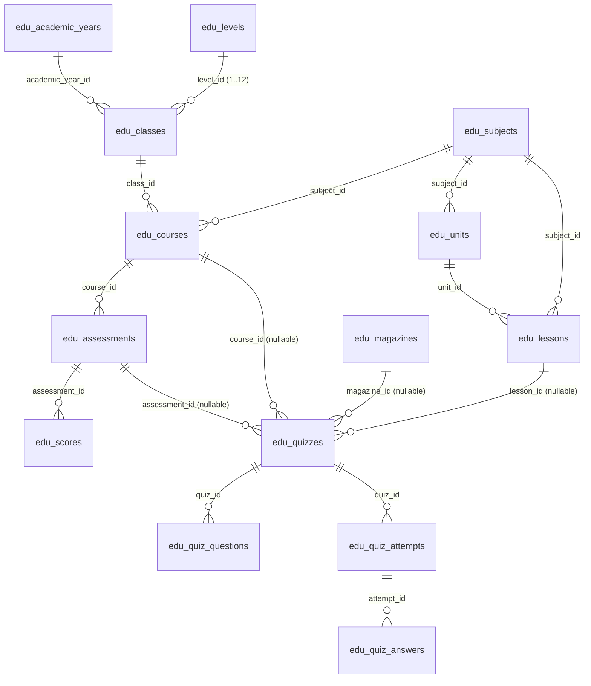

# CURRENT SYSTEM INVESTIGATION REPORT
**Project:** Mezmur Zemseretee Hiwot (MH-app-1.5.3)  
**Modules Investigated:** Education, Quizzes & Assessments, Administration & Program Calendar, Media Migration, Attendance  
**Investigation Date:** November 2026  
**Status:** Completed In-Depth Audit (Technical Baseline)

---

## EXECUTIVE SUMMARY

This investigation was conducted across the Flutter mobile application (`mobile/mobile/lib/`), the Laravel PHP backend (`laravel/app/Mz/`, `laravel/routes/api/`, `laravel/database/`), and the MySQL relational database schema. Every issue reported has been traced to its exact root causes in the codebase, distinguishing between confirmed bugs, incomplete implementations, missing functionality, UI/navigation defects, permission flaws, and architectural bottlenecks.

---

## 1. EDUCATION MODULE — PERFORMANCE & LOADING ARCHITECTURE

### 1.1 Confirmed Issues & Symptoms
- **Symptom 1:** Navigating to the Education Home screen (`/edu`) frequently stalls on:
  ```
  "Loading your education data..." / "በመጫን ላይ..."
  ```
- **Symptom 2:** Opening the Overall Progress screen (`/edu/progress`) blocks the entire interface displaying:
  ```
  "Loading progress data..." / "የትምህርት እድገት በመጫን ላይ..."
  ```
- **Symptom 3:** Returning to Education Home or switching tabs immediately destroys previously loaded data and re-triggers the full-screen blocking loader.

### 1.2 Actual Root Causes

#### A. Monolithic, Uncached Backend Endpoints with Severe N+1 Database Queries
1. **Endpoint `GET /api/v1/edu/me/dashboard`:**
   - **File:** [laravel/app/Mz/Services/EduDashboard.php](file:///c:/Users/HP/Documents/MH-app-1.5.3/laravel/app/Mz/Services/EduDashboard.php#L20-L50) (`EduDashboard::forUser`)
   - **Behavior:** Executes over 18 sequential SQL queries in a single synchronous HTTP request:
     - `Edu::overview($auth)` (classes, teaching, enrollments, registrations)
     - `Edu::myCourseIds($auth->id)`
     - `Edu::myTeachingCourseIds($auth->id)`
     - `EduLearning::studentAssignedGrades($auth->id)`
     - `EduLearning::studentAssignedClassSubjects($auth->id)`
     - `EduLearning::featured($auth)`
     - `EduLearning::categories($auth)`
     - `EduLearning::subjects($auth, null)`
     - `EduLearning::continueLearning($auth)`
     - `Library::books($auth, ['domain' => 'timhirt'], ['page' => 1, 'limit' => 6])`
     - `self::student($auth, ...)`:
       - Iterates over active assignments checking submissions in a loop:
         ```php
         foreach ($assignments as $a) {
             $hasSubmission = DB::table('edu_assignment_submissions')->where(...)->exists()
                 || DB::table('edu_submissions')->where(...)->exists(); // N+1 query!
         }
         ```
       - Calls `EduQuizzes::mine($auth)`: loads all quizzes, all student attempts, questions, and scores.
       - Iterates over classes executing attendance summaries:
         ```php
         foreach ($classes as $c) {
             $s = Edu::attendanceSummary((int) $c['id'], $auth->id); // N+1 query!
         }
         ```
       - Executes queries for academic period, outcomes (`EduOutcomes::forStudent`), retakes (`EduRetakes::list`), and certificates (`EduCertificates::myCertificates`).
     - `self::teaching(...)` (5 aggregate queries counting submissions, rejected marks, drafts).
     - `self::admin()` (6 aggregate queries counting unlinked subjects, open complaints, etc.).
   - **Caching:** Zero backend caching. No `Cache::remember()`, no Redis tag caching, no ETag or HTTP conditional headers (`If-None-Match`). Every visit causes a full database stampede.

2. **Endpoint `GET /api/v1/edu/me/progress`:**
   - **File:** [laravel/app/Mz/Services/EduDashboard.php](file:///c:/Users/HP/Documents/MH-app-1.5.3/laravel/app/Mz/Services/EduDashboard.php#L225-L380) (`EduDashboard::progress`)
   - **Behavior:**
     - Runs `Edu::overview($auth)`, then loops over every enrolled class calling `Edu::myResults($auth, (int) $c['id'])`. Inside `myResults`, it fetches courses, student attendance percentages, and score sheets.
     - Runs `EduLearning::subjects($auth, null)`.
     - Runs a loop over assignments to detect pending work (`DB::table('edu_submissions')->where(...)->first()` inside foreach — N+1 query).
     - Runs `EduQuizzes::mine($auth)` and loops through every attempt.
     - Executes multiple subqueries for recent completions and recent quiz attempts.
   - **Result:** Overall Progress takes 2.5s–6.0s on real mobile connections, blocking the user completely.

#### B. Flawed Riverpod State Management & Aggressive Auto-Disposal
1. **Auto-Disposal on Critical Providers:**
   - **File:** [mobile/mobile/lib/features/edu/learn/edu_home.dart](file:///c:/Users/HP/Documents/MH-app-1.5.3/mobile/mobile/lib/features/edu/learn/edu_home.dart#L33-L36)
     ```dart
     final eduDashboardProvider = FutureProvider.autoDispose<Json>(
       (ref) => ref.watch(eduRepositoryProvider).dashboard(),
     );
     ```
   - **File:** [mobile/mobile/lib/features/edu/learn/progress_more.dart](file:///c:/Users/HP/Documents/MH-app-1.5.3/mobile/mobile/lib/features/edu/learn/progress_more.dart#L19-L21)
     ```dart
     final _progressProvider = FutureProvider.autoDispose<Json>(
       (ref) => ref.watch(eduRepositoryProvider).progress(),
     );
     ```
   - **Impact:** `.autoDispose` immediately tears down the provider cache the moment the user navigates away (e.g. to open a lesson, check notifications, or switch tabs). When the user returns, the entire tree is destroyed, causing a full reload.

2. **Full-Screen All-or-Nothing Blocking Views:**
   - In `EduHomeScreen`:
     ```dart
     dashAsync.when(
       data: (d) => _HomeBody(data: d, refresh: refresh),
       loading: () => const _HomeSkeletonLoading(),
       error: (err, _) => _HomeErrorView(onRetry: refresh, error: err),
     )
     ```
   - `_HomeSkeletonLoading` ([edu_home.dart](file:///c:/Users/HP/Documents/MH-app-1.5.3/mobile/mobile/lib/features/edu/learn/edu_home.dart#L1212-L1285)) replaces the entire screen with a spinner and `'Loading your education data...'`.
   - In `EduProgressScreen`:
     `loading: () => const _ProgressSkeletonLoading()` ([progress_more.dart](file:///c:/Users/HP/Documents/MH-app-1.5.3/mobile/mobile/lib/features/edu/learn/progress_more.dart#L141-L144)) displays a full-screen spinner with `'Loading progress data...'`.
   - Independent sections (Quick shortcuts, My Subjects, Books, Magazine banner) are trapped behind this monolithic loading state.

3. **Redundant & Uncoordinated Duplicate Requests:**
   - `EduHomeScreen` triggers `eduDashboardProvider`, which already loads `Library::books(...)` on the backend.
   - However, `_HomeBooksPreview` ([edu_home.dart](file:///c:/Users/HP/Documents/MH-app-1.5.3/mobile/mobile/lib/features/edu/learn/edu_home.dart#L675-L680)) triggers an independent network request `eduHomeBooksProvider` (`libraryRepository.books(domain: 'timhirt')`).
   - `SeledaMagazineBanner` simultaneously triggers `latestMagazineProvider` (`/edu/magazines/latest`).
   - Multiple parallel uncoordinated HTTP requests flood the connection on entry.

---

## 2. OVERALL PROGRESS — CONTINUE LEARNING RECOMMENDATION DEFECTS

### 2.1 Confirmed Issues & Symptoms
- The Continue Learning card and Recommended Next action recommend random courses or lessons that do not belong to the student's assigned class curriculum (e.g., a Grade 7 student is shown Grade 1 catechism or unassigned adult theology).
- The sequence does not adhere to curriculum progression.

### 2.2 Actual Root Causes

#### A. Backend Query Completely Disconnected from Class Curriculum
In [laravel/app/Mz/Services/EduDashboard.php](file:///c:/Users/HP/Documents/MH-app-1.5.3/laravel/app/Mz/Services/EduDashboard.php#L393-L415) (`EduDashboard::progress`):
```php
// Find an unfinished lesson from subjects
$incompLesson = DB::table('edu_lessons as l')
    ->join('edu_subjects as s', 's.id', '=', 'l.subject_id')
    ->leftJoin('edu_lesson_progress as p', fn ($j) => $j->on('p.lesson_id', '=', 'l.id')->where('p.user_id', '=', $auth->id))
    ->where('s.status', 'published')
    ->where(fn ($w) => $w->whereNull('p.completed_at')->orWhere('p.completed_at', ''))
    ->orderBy('s.sort_order')
    ->orderBy('l.sort_order')
    ->first(['l.id as lesson_id', 'l.title as lesson_title', 's.name as subject_name', 's.name_en as subject_name_en']);
```
**Fatal Flaw:**
This query selects ANY incomplete lesson from ANY published subject in `edu_subjects` ordered by `s.sort_order`. It does NOT join `edu_classes`, `edu_enrollments`, or `edu_courses`. If Subject 1 is Grade 1 "ትምህርተ ሃይማኖት", every student in the system (Grade 7, Grade 12, etc.) is recommended Grade 1 Lesson 1!

#### B. Fallback in `EduLearning::continueLearning` Depends on Unrestricted History
In [laravel/app/Mz/Services/EduLearning.php](file:///c:/Users/HP/Documents/MH-app-1.5.3/laravel/app/Mz/Services/EduLearning.php#L929-L956):
```php
$recent = DB::table('edu_lesson_progress as p')
    ->join('edu_lessons as l', 'l.id', '=', 'p.lesson_id')
    ->join('edu_subjects as s', 's.id', '=', 'l.subject_id')
    ->where('p.user_id', $auth->id)
    ->where('l.status', 'published')
    ->where('s.status', 'published')
    ->orderByDesc('p.last_opened_at')->limit(10)->get();
```
- If a student has no prior progress history, it returns `null`.
- If a student previously clicked on any random subject outside their grade, it anchors future recommendations to that incorrect subject.

#### C. Incomplete Subject Progress Population in `studentAssignedClassSubjects`
In [laravel/app/Mz/Services/EduLearning.php](file:///c:/Users/HP/Documents/MH-app-1.5.3/laravel/app/Mz/Services/EduLearning.php#L425-L440):
```php
$serialized = self::serializeSubject($c) + [
    'assigned_grade' => $meta['grade'] ?: (int) ($c->grade ?: 1),
    'class_id' => (int) $c->class_id,
    'class_name' => $meta['class_name'],
    'can_open' => true,
    'enrolled' => true,
    'my_progress' => ['completed' => 0, 'total' => (int) ($c->lesson_count ?? 0), 'percent' => 0],
];
```
When `EduLearning::subjects($auth, null)` calls `studentAssignedClassSubjects`, it hardcodes `'completed' => 0, 'percent' => 0` and skips `self::subjectProgress(...)`. As a result, the progress calculation logic receives zero completion data for curriculum-assigned subjects.

---

## 3. CLASS NAVIGATION — STRICT CURRICULUM ACCESS CONTROL

### 3.1 Confirmed Issues & Symptoms
- Navigation subtitle in Education Home displays:
  ```
  "Subject (Select a subject to browse grade curriculum 1–12)" /
  "ከ1ኛ እስከ 12ኛ ክፍል ያሉትን ትምህርቶች ለመመልከት የትምህርት ዓይነት ይምረጡ"
  ```
- Students can browse, open, and view subjects, lessons, and materials from other grades across categories, search, deep links, and material downloads.

### 3.2 Actual Root Causes Across All Access Points

| Access Point | Code Location | Root Cause |
| :--- | :--- | :--- |
| **Education Home** | `mobile/mobile/lib/features/edu/learn/edu_home.dart` (L1445–L1480) | `CanonicalCategoriesSection` displays 7 canonical category cards with explicit label to browse 1–12 and navigates to `/edu/learn/category/:id`. |
| **Category Grade Browser** | `mobile/mobile/lib/features/edu/learn/learn_screens.dart` (L267–L435) | `EduCategoryScreen` displays section `Grades (1 - 12)` and lists all subjects for all grades under that category. |
| **Category API Endpoint** | `laravel/routes/api/edu_learning.php` (L37) -> `EduLearning::subjects` | When `categoryId` is provided, `EduLearning::subjects` completely bypasses `studentAssignedClassSubjects` and returns all subjects where `status = 'published'` across all grades 1–12. |
| **Permission Check Bypass** | `laravel/app/Mz/Services/EduLearning.php` (L90–L96) | `canOpen()` checks: `if ($s->visibility === 'members') return true;`. Because canonical subjects default to `visibility = 'members'`, ANY student passes authorization for ANY grade's subject! |
| **Subject Detail API** | `laravel/app/Mz/Services/EduLearning.php` (L701–L725) | `subjectDetail` uses `canOpen()`. It does NOT verify whether `$s->grade` matches the student's active enrollment in `edu_enrollments`. |
| **Lesson Detail API** | `laravel/app/Mz/Services/EduLearning.php` (L850–L865) | `lessonDetail` calls `canOpen($auth, $s)`. Any student can open lessons for Grade 12 or Grade 1. |
| **Search API** | `laravel/app/Mz/Services/EduLearning.php` (L1030–L1080) | `EduLearning::search` returns subjects, courses, and lessons across all grades where `visibility = 'members'`. |
| **Material Downloads** | `laravel/app/Mz/Services/EduLearning.php` (L1135–L1160) | For lesson materials (`m->lesson_id`), `materialFile` checks `canOpen($auth, $s)`. Because `canOpen` returns true, students can download learning materials of any grade. |
| **Direct Routes & Deep Links** | `mobile/mobile/lib/app/router.dart` (L289–L298), `deep_links.dart` | Routes `/edu/learn/subject/:id` and `/edu/learn/lesson/:id` directly instantiate `EduSubjectScreen` and `EduLessonScreen` without validating student grade enrollment against the subject grade. |

---

## 4. QUIZZES AND ASSESSMENTS — ARCHITECTURAL BREAKDOWN & BUGS

### 4.1 Bug A: Closing Exam Creation — "Assessment ID is required"
- **Symptom:** Admin clicks "Create Closing Exam" -> Form displays error: `"Assessment ID is required."` even though there is no input field for it.
- **Root Cause Identified (Exact Code Match):**
  1. In [laravel/routes/api/edu_learning.php](file:///c:/Users/HP/Documents/MH-app-1.5.3/laravel/routes/api/edu_learning.php#L230-L265):
     The backend endpoint `POST /courses/{id}/assessments/ensure-final` creates/finds the assessment and returns:
     ```php
     return Http::created(['assessment_id' => (int) $newId, 'title' => $insert['title']]);
     ```
     The JSON payload key returned is **`assessment_id`**.
  2. In [mobile/mobile/lib/features/edu/learn/quizzes_admin.dart](file:///c:/Users/HP/Documents/MH-app-1.5.3/mobile/mobile/lib/features/edu/learn/quizzes_admin.dart#L120-L127):
     ```dart
     final assess = await repo.ensureFinalAssessment(result.targetId);
     final assessId = asInt(assess['id']); // <--- BUG! Key is 'assessment_id', NOT 'id'!
     return repo.createQuiz(result.targetId, {
       'title': result.title,
       'kind': 'exam',
       'assessment_id': assessId, // Passes NULL!
     });
     ```
     `asInt(assess['id'])` evaluates to `null`.
  3. In [laravel/app/Mz/Services/EduQuizzes.php](file:///c:/Users/HP/Documents/MH-app-1.5.3/laravel/app/Mz/Services/EduQuizzes.php#L429):
     ```php
     if (($in['kind'] ?? 'quiz') === 'exam') {
         if (empty($in['assessment_id'])) throw ApiError::field('assessment_id', 'ASSESSMENT_REQUIRED');
         $in['max_attempts'] ??= 1;
     }
     ```
     Because `assessment_id` is null, Laravel throws `ApiError::field('assessment_id', 'ASSESSMENT_REQUIRED')`, surfacing as `"Assessment ID is required."` on the client.

### 4.2 Bug B: Class Course Quiz — Only Grade 6 Appears
- **Symptom:** When creating a class course quiz, selecting all classes only lists Grade 6.
- **Root Cause Identified:**
  In [mobile/mobile/lib/features/edu/learn/quizzes_admin.dart](file:///c:/Users/HP/Documents/MH-app-1.5.3/mobile/mobile/lib/features/edu/learn/quizzes_admin.dart#L45-L55) (`_loadAll`):
  ```dart
  final results = await Future.wait([
    repo.subjects(all: true),
    repo.teaching().catchError((_) => <Json>[]), // <--- POPULATES _courses!
    repo.allAdminQuizzes(),
  ]);
  _subjects = results[0];
  _courses = results[1];
  ```
  `_courses` is loaded from `repo.teaching()` (`GET /edu/teaching` -> `EduTeachers::teaching`).
  In [laravel/app/Mz/Services/EduTeachers.php](file:///c:/Users/HP/Documents/MH-app-1.5.3/laravel/app/Mz/Services/EduTeachers.php#L37-L45):
  ```php
  public static function teaching(AuthContext $auth): array
  {
      return DB::table('edu_course_teachers as t')
          ->join('edu_courses as co', 'co.id', '=', 't.course_id')
          ->join('edu_classes as c', 'c.id', '=', 'co.class_id')
          ->where(['t.user_id' => $auth->id, 't.status' => 'active'])
          ...
  ```
  `EduTeachers::teaching` ONLY returns courses where the logged-in user is explicitly assigned as a teacher in `edu_course_teachers`.
  If the administrator happens to be assigned as a teacher for a Grade 6 course, ONLY Grade 6 appears!
  The quiz creation dialog fails to check if the user is an Education Administrator (`Perm.educationManage`). Administrators must be provided all active classes and courses via `Edu::adminClasses()` and `EduRegistration::classes()`.

### 4.3 Existing Assessment Relationship Mapping


#### Identified Deficiencies in Assessment Connections:
1. `edu_assessments` is strictly coupled to `course_id`. It has no direct foreign key to `class_id`, `academic_year_id`, `term_id`, or `subject_id`.
2. There is no mechanism to attach an assessment to an entire grade level across multiple classes (e.g. all Grade 7 sections taking the same closing exam).
3. `edu_quizzes` links to `edu_assessments` through a nullable `assessment_id` foreign key. However, when creating a general quiz or lesson quiz, creating an assessment record is bypassed entirely, meaning lesson quizzes do not show up in the formal academic grade book (`edu_scores`).

---

## 5. UNIFIED QUIZ SYSTEM & MAGAZINE INTEGRATION

### 5.1 Current Implementation Comparison
| Feature | Magazine Quiz (`magazine_admin.dart`) | Main Quiz System (`quiz_screens.dart`, `quizzes_admin.dart`) |
| :--- | :--- | :--- |
| **Interface** | `EduMagazineQuizEditorDialog` (Modal Dialog) | `EduQuizEditorScreen` (Full Screen) |
| **Title & Instructions** | Amharic only | Bilingual (`title`, `title_en`, `instructions`, `instructions_en`) |
| **Question Editor** | **None.** Cannot add or edit questions in dialog! | Full inline question editor (`_QuestionEditor`) |
| **Question Types** | None | `single`, `multiple`, `true_false`, `short_text` |
| **Time Limits** | Minutes only | Minutes, scheduling (`opens_at`, `closes_at`) |
| **Scoring & Review** | Hardcoded | Configurable (`best`/`last`, `after_submit`, `after_close`) |
| **Action from Card** | Always shows `+ Add Quiz` even if quiz exists | Shows status, edit, preview, delete, results |

### 5.2 Magazine Quiz Business Rules
- Magazine quizzes are linked via `edu_quizzes.magazine_id`.
- Business rules: Available for 7 days (`closes_at = now + 7 days`) and restricted to 1 attempt (`max_attempts = 1`).
- The current implementation breaks down because once the dialog creates the `edu_quizzes` row, there is no UI pathway to attach questions to that quiz from the magazine admin panel!

---

## 6. QUESTION BANK (F12) DEPENDENCY INVESTIGATION

### 6.1 Database Dependencies
- **Table `edu_question_banks`:** Stores bank repositories (`id`, `subject_id`, `title`, `category`, `created_by`, `timestamps`).
- **Table `edu_quiz_draws`:** Stores dynamic draw rules (`id`, `quiz_id`, `bank_id`, `count`, `points_each`, `timestamps`).
- **Table `edu_quiz_questions`:**
  - Column `bank_id` (nullable unsigned integer).
  - Column `quiz_id` was altered in migration `2026_10_20_000003_edu_results_pipeline.php` to be nullable so questions could exist in a bank without belonging to a quiz.

### 6.2 Backend Code Dependencies
- **Service:** [laravel/app/Mz/Services/EduQuizzes.php](file:///c:/Users/HP/Documents/MH-app-1.5.3/laravel/app/Mz/Services/EduQuizzes.php#L1166-L1320)
  - `createBank()`, `listBanks()`, `getBank()`, `setBankQuestions()`, `deleteBank()`
  - `setDraws()`, `getDraws()`
  - `EduQuizzes::start()` lines 815–840: dynamically draws random questions from `edu_quiz_draws` and merges with direct quiz questions.
  - `EduQuizzes::teacherQuiz()` lines 105–108: queries `edu_quiz_draws` for draw counts and points.
- **Routes:** [laravel/routes/api/edu_learning.php](file:///c:/Users/HP/Documents/MH-app-1.5.3/laravel/routes/api/edu_learning.php#L302-L320)
  - `GET /edu/subjects/{id}/question-banks`
  - `POST /edu/subjects/{id}/question-banks`
  - `GET /edu/question-banks/{id}`
  - `PUT /edu/question-banks/{id}/questions`
  - `DELETE /edu/question-banks/{id}`
  - `GET /edu/quizzes/{id}/draws`
  - `PUT /edu/quizzes/{id}/draws`

### 6.3 Frontend Dependencies
- **Screen:** `mobile/mobile/lib/features/edu/learn/quizzes_admin.dart`
  - Appbar action button: `IconButton(tooltip: isEn ? 'Question Banks (F12)' : 'የጥያቄዎች ባንክ', ...)`
  - Sheet class: `_QuestionBanksSheet` (lines 1033–1250)
- **Repository:** `mobile/mobile/lib/repositories/superapp_repositories.dart`
  - `questionBanks()`, `createQuestionBank()`, `questionBank()`, `setQuestionBankQuestions()`, `quizDraws()`, `setQuizDraws()`.

### 6.4 Crucial Safety Verification
- Standard quizzes, exams, and magazine quizzes store their questions directly in `edu_quiz_questions` with `quiz_id != null` and `bank_id = null`.
- None of the standard assessment, grading, or reporting pipelines depend on `edu_question_banks`.
- Removing the Question Bank UI and disconnecting `edu_quiz_draws` will NOT break existing quiz questions, student attempts, or grades.

---

## 7. MAIN ADMIN PANEL — PROGRAM CALENDAR BLACK SCREEN

### 7.1 Confirmed Symptom
In the Main Admin Panel (`/admin/programs`), clicking the Calendar action in the AppBar causes the screen to fail to open or display a solid black/blank screen.

### 7.2 Actual Root Causes

#### A. Shell Route Navigation Mismatch in GoRouter
1. **Route Declaration in [mobile/mobile/lib/app/router.dart](file:///c:/Users/HP/Documents/MH-app-1.5.3/mobile/mobile/lib/app/router.dart#L713-L720):**
   ```dart
   StatefulShellBranch(routes: [
     GoRoute(
       path: '/programs',
       builder: (_, _) => const ProgramsScreen(),
       routes: [
         GoRoute(path: 'calendar', builder: (_, _) => const UnifiedCalendarScreen()),
         GoRoute(path: ':id', builder: (_, s) => ProgramDetailScreen(programId: _id(s))),
       ],
     ),
   ]),
   ```
2. **Navigation Trigger in [mobile/mobile/lib/features/admin/programs_admin.dart](file:///c:/Users/HP/Documents/MH-app-1.5.3/mobile/mobile/lib/features/admin/programs_admin.dart#L116-L119):**
   ```dart
   IconButton(
     icon: const Icon(Icons.calendar_month_rounded),
     tooltip: 'የቀን መቁጠሪያ (Calendar)',
     onPressed: () => context.push('/programs/calendar'),
   ),
   ```
3. **The Clash:**
   - `/admin/programs` is pushed on the root navigator (`rootNavigatorKey`).
   - Calling `context.push('/programs/calendar')` attempts to navigate to a child route of the `StatefulShellRoute` from outside the shell without switching the active shell index.
   - In GoRouter on Web and mobile, pushing a branch sub-route from the root navigator without `parentNavigatorKey: rootNavigatorKey` causes navigation state corruption, resulting in an unrendered Scaffold (solid black screen).

#### B. Layout Exception in `UnifiedCalendarScreen`
In [mobile/mobile/lib/features/programs/calendar/unified_calendar_screen.dart](file:///c:/Users/HP/Documents/MH-app-1.5.3/mobile/mobile/lib/features/programs/calendar/unified_calendar_screen.dart#L540-L610):
- `_buildYearlyView` creates a 3-column `GridView.builder`.
- Inside each month tile's `Column`, it wraps `Expanded(child: _buildMiniMonthGrid(...))`.
- `_buildMiniMonthGrid` itself returns another `GridView.builder` with 7 columns for 30 days!
- In Flutter, nesting an unconstrained `GridView.builder` inside an `Expanded` inside a fixed aspect-ratio grid tile causes an unbounded height / layout overflow exception. In production builds, this unhandled build exception renders as a black screen.

---

## 8. MEDIA MIGRATION AND STORAGE — PENDING AUDIO TIMEOUT

### 8.1 Confirmed Symptom
When converting pending Mezmur audio files in the Media Migration screen (`/admin/media-migration`), the request crashes after 30 seconds with:
```
ApiException(null, TIMEOUT, null)
```
The audio files remain in `pending` or `processing` state and are never converted.

### 8.2 Actual Root Causes

#### A. Strict 30-Second Client Timeout in Flutter
In [mobile/mobile/lib/core/config/app_config.dart](file:///c:/Users/HP/Documents/MH-app-1.5.3/mobile/mobile/lib/core/config/app_config.dart#L14):
```dart
static const receiveTimeout = Duration(seconds: 30);
```
In [mobile/mobile/lib/core/network/api_exception.dart](file:///c:/Users/HP/Documents/MH-app-1.5.3/mobile/mobile/lib/core/network/api_exception.dart#L43):
When Dio hits `receiveTimeout`, it generates `ApiException(null, TIMEOUT, null)`.

#### B. Heavy Synchronous Execution in PHP HTTP Request
In [laravel/app/Mz/Services/MediaMigration.php](file:///c:/Users/HP/Documents/MH-app-1.5.3/laravel/app/Mz/Services/MediaMigration.php#L358-L395) (`runBatch`):
- The endpoint `POST /api/v1/admin/media-migration/run` accepts a batch size of up to 20 or 50 items.
- It executes `self::processItem(...)` in a synchronous `foreach` loop.
- In `processAudio`:
  1. Copies original audio to `storage/app/backups/audio/` (file I/O).
  2. Runs external FFmpeg process:
     ```php
     $cmd = escapeshellcmd($ffmpeg) . ' -y -i ' . escapeshellarg($sourceAbsPath)
          . ' -vn -c:a aac -b:a 128k -ar 44100 -movflags +faststart '
          . escapeshellarg($targetAbsPath) . ' 2>&1';
     exec($cmd, $output, $exitCode);
     ```
  3. Validates M4A binary header.
- A single 10MB–40MB high-fidelity church hymn or liturgical audio file takes 8 to 25 seconds for FFmpeg to re-encode on CPU.
- Processing 2 or more files synchronously guaranteed that execution exceeded 30 seconds. Dio severed the connection, and PHP either was killed by `max_execution_time` or completed in the background with no client to receive the response.

---

## 9. ATTENDANCE MANAGEMENT ARCHITECTURE & DEFICIENCIES

### 9.1 Confirmed Issues
1. **Take Attendance is Inaccessible from Main Admin:**
   - Navigating to `/admin/programs` only offers "Attendance Roster" buried in a three-dots popup menu on individual items.
   - Navigating to `/admin/attendance` opens `AttendanceManagementScreen`, which is purely an analytics/reporting dashboard (Year Analytics, Month Details, By Program, By Member) with zero buttons or workflows to take attendance.
2. **Fragmented Attendance Functions:**
   - Permission Requests are isolated at `/admin/permissions` (`PermissionRequestsScreen`).
   - Attendance Corrections are hidden inside a dialog in `stage_admin.dart` (`requestAttendanceCorrection`).
   - Digital signatures are stored in `attendance_signatures` but only accessible as tiny icon popups with no dedicated verification review screen.
   - Offline sync conflicts and queued records are managed solely by background services without a manual administrative reconciliation interface.

### 9.2 Existing Backend Attendance Assets (Ready for Reuse)
The backend service [laravel/app/Mz/Services/Attendance.php](file:///c:/Users/HP/Documents/MH-app-1.5.3/laravel/app/Mz/Services/Attendance.php) already contains powerful, verified operations:
- `identify()` & `record()`: Supports QR code UUID verification and manual user selection.
- `attachSignature()`: Captures signature PNG and SHA-256 hash.
- `requestCorrection()` & `reviewCorrection()`: Full lifecycle for correcting attendance records with approval logs.
- `signatureFile()`: Secure file streaming of digital signatures.
- `listCorrections()`: Full pagination and filtering for correction requests.

---

## 10. INVESTIGATION SUMMARY TABLE

| Topic | Current Status | Root Cause Category | Key File & Line |
| :--- | :--- | :--- | :--- |
| **Education Home Loading** | Heavy & Slow | Performance / N+1 Queries / AutoDispose | `EduDashboard.php#L20`, `edu_home.dart#L33` |
| **Overall Progress Loading** | Heavy & Slow | Performance / N+1 Queries / AutoDispose | `EduDashboard.php#L225`, `progress_more.dart#L19` |
| **Continue Learning Randomness** | Defect | Missing Curriculum & Class Filtering | `EduDashboard.php#L395` |
| **Class Navigation 1-12 Leak** | Architecture Flaw | Permissive `canOpen` & Category Navigation | `edu_home.dart#L1455`, `EduLearning.php#L94` |
| **Closing Exam Error** | Confirmed Bug | Mismatched API Response Key (`assessment_id` vs `id`) | `quizzes_admin.dart#L122`, `EduQuizzes.php#L429` |
| **Class Course Quiz Only Gr 6** | Confirmed Bug | Calling `repo.teaching()` instead of admin classes | `quizzes_admin.dart#L49`, `EduTeachers.php#L37` |
| **Question Bank Removal** | Redundant Feature | F12 feature isolated; safe to remove | `quizzes_admin.dart#L1033`, `EduQuizzes.php#L1166` |
| **Program Calendar Black Screen** | Routing / Layout Bug | ShellRoute mismatch + Nested GridView layout crash | `programs_admin.dart#L118`, `unified_calendar_screen.dart#L560` |
| **Media Migration Timeout** | Performance Bug | Synchronous FFmpeg in HTTP request vs 30s Dio timeout | `MediaMigration.php#L388`, `app_config.dart#L14` |
| **Attendance Fragmentation** | UI/Navigation Gap | Features scattered; no central "Take Attendance" hub | `admin_home.dart#L189`, `attendance_management_screen.dart` |

---
*Report completed based on source code inspection of MH-app-1.5.3.*
