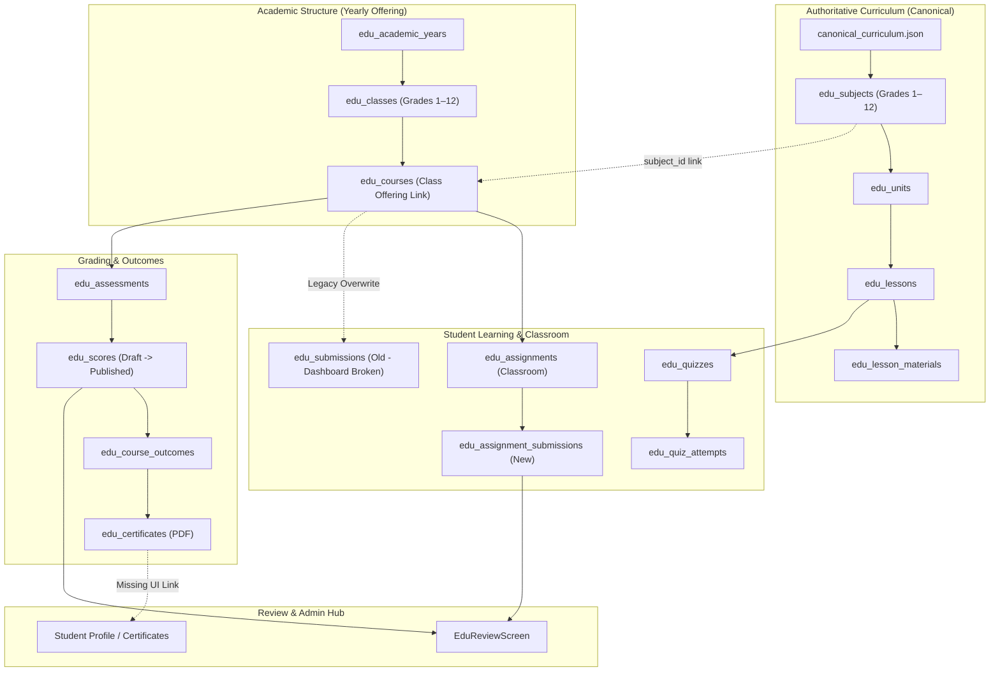

# Comprehensive Education Module Architectural, Functional & Duplication Audit

**Project:** Mezmur Zemseretee Hiwot  
**Codebase:** Flutter (`mobile/mobile`) & Laravel (`laravel`)  
**Audit Type:** Deep Architectural, Functional, Security & Data-Integrity Audit (Analysis Only — Zero Code Changes)  
**Date:** November 2026  
**Status:** Audit Complete. Awaiting User Review and Instructions.

---

## A. Executive Summary

### 1. Overall Education Module Condition
The Education module in Mezmur Zemseretee Hiwot is a sophisticated, feature-rich domain encompassing Sunday School class management, a canonical 12-grade curriculum, interactive online assessments, homework assignments, a student academic journey, confidential appeals, and digital magazine publishing.

However, an exhaustive end-to-end trace reveals that the module is caught between **two architectural generations**:
1. **The Legacy Class-Centric Offering Model (v1.5.0–1.5.2):** Built around physical class batches, academic terms, legacy single-file homework submissions (`edu_submissions`), physical class attendance rosters, and ad-hoc course creation.
2. **The Modern Canonical Curriculum & Classroom Model (v1.5.3+):** Built around 7 Canonical Categories, Grades 1–12 (`canonical_curriculum.json`), Google Classroom-style stream feeds (`edu_assignments` / `edu_announcements`), online quiz attempts, and digital Seleda Magazine issues.

Because the system was upgraded incrementally without retiring older routes, screens, and tables, several core features now exist in **duplicate pipelines**, critical routes **collide and overwrite one another**, certain database tables are completely **desynchronized**, and multiple Flutter screens are **orphaned or redirected away**.

### 2. Main Architectural Problems
- **Duplicate & Colliding API Routes:** Because Laravel loads all route files via `glob('routes/api/*.php')`, routes defined in `edu_assignments.php` (such as `POST /edu/assignments/{id}/submit` and `GET /edu/courses/{id}/assignments`) completely overwrite routes with the exact same path in `edu.php`.
- **Desynchronized Dual Submission Tables:** Homework assignments are written to `edu_assignment_submissions` by the modern Classroom screen, but `EduDashboard.php` and `EduScores.php` query the legacy `edu_submissions` table. Consequently, submitted assignments continue to show up as "Due Soon" or "Overdue" on the student dashboard indefinitely.
- **Fatal Undefined Method in Production:** `GET /edu/courses/{id}/completion` (called by Flutter and used by `EduCertificates::eligible` to check online course completion) calls `EduLearning::courseCompletion()`, which **does not exist** in `EduLearning.php`. Invoking it triggers a fatal 500 error.
- **Missing `$hasGradeCol` Variable in Curriculum Auto-Sync:** In [`Edu.php:558`](file:///c:/Users/HP/Documents/MH-app-1.5.3/laravel/app/Mz/Services/Edu.php#L558) and `line 572`, `connectClassToCurriculum()` queries `edu_subjects` using `->when($hasGradeCol, ...)` without first initializing `$hasGradeCol`. In strict PHP 8.2+, this produces an `Undefined variable $hasGradeCol` warning/error.
- **Teacher Report Card & Score Authorization Gap:** `EduReportCard` and `EduScores` check teacher authorization by inspecting `edu_courses.teacher_user_id` (a legacy single-teacher column). However, the actual multi-teacher model used by `EduTeachers.php` and `EduCourseTeachersSheet` assigns instructors via the `edu_course_teachers` junction table. As a result, teachers officially assigned to courses are blocked with `FORBIDDEN` when trying to view their students' scores or report cards.

### 3. Most Serious Disconnected & Orphaned Functionality
- **`EduUnitsLessonsAdminScreen.dart` (700 lines of Flutter code)**: Fully implements units and lessons administrative management, but `router.dart` redirects `/edu/content/units-lessons` away. It is dead code.
- **`EduAcademicCalendarScreen.dart` (610 lines of Flutter code)**: Fully implements Ethiopian calendar academic years, configurable terms, and grade levels, but `router.dart` redirects `/edu/calendar` to `/edu`. It is dead code.
- **Student Certificates Screen**: Certificates can be generated on the backend, and `EduRepository.myCertificates()` is defined, but `/edu/certificates` is redirected to `/edu`. Students have no UI to view or download their earned certificates.
- **Missing Admin Panel Cards**: The modern Classroom Assignments (`/edu/assignments`) and Announcements (`/edu/announcements`) screens are missing from [`EduAdminPanelScreen`](file:///c:/Users/HP/Documents/MH-app-1.5.3/mobile/mobile/lib/features/edu/edu_admin_panel.dart).

---

## B. Complete Feature Inventory

| Feature | Flutter Implementation | Backend Implementation | Database Persistence | Integration Status |
| :--- | :--- | :--- | :--- | :--- |
| **Education Dashboard & Hub** | [`EduHomeScreen`](file:///c:/Users/HP/Documents/MH-app-1.5.3/mobile/mobile/lib/features/edu/learn/edu_home.dart#L43) (`/edu`) | `EduDashboard::forUser`, `Edu::overview` | `edu_classes`, `edu_assignments`, `edu_quizzes` | **Functional** (Central active hub) |
| **Canonical Subject Grades Browsing** | [`EduSubjectGradesScreen`](file:///c:/Users/HP/Documents/MH-app-1.5.3/mobile/mobile/lib/features/edu/learn/subject_grades_screen.dart#L20) (`/edu/subject/:id/grades`) | `EduLearning::subjectGrades` | `edu_subjects`, `edu_levels` | **Functional** (12 grades breakdown) |
| **Grade Content & Scoped Lessons** | [`EduGradeContentScreen`](file:///c:/Users/HP/Documents/MH-app-1.5.3/mobile/mobile/lib/features/edu/learn/grade_content_screen.dart#L40) (`/edu/subject/:id/grade/:grade`) | `EduLearning::subjectGradeContent` | `edu_units`, `edu_lessons`, `edu_lesson_materials` | **Functional** (Curriculum content view) |
| **Direct Course Materials (Feature B)** | BottomSheet in `EduGradeContentScreen` | `EduLearning::addDirectMaterialFile` | `edu_lesson_materials` (`grade`, `category_id`) | **Mismatched / Broken Route** (Flutter sends `subjectId` to endpoint expecting `categoryId`) |
| **Canonical Admin Grades (Feature C)** | [`EduAdminGradesScreen`](file:///c:/Users/HP/Documents/MH-app-1.5.3/mobile/mobile/lib/features/edu/admin/admin_grades_screen.dart#L17) (`/edu/admin/grades`) | `EduAcademicYears::levels`, `EduAcademicYears::updateLevel` | `edu_levels` | **Functional** |
| **Classroom Assignments (Feature D)** | [`EduAssignmentsScreen`](file:///c:/Users/HP/Documents/MH-app-1.5.3/mobile/mobile/lib/features/edu/assignments/assignments_screens.dart#L36), [`EduAssignmentDetailScreen`](file:///c:/Users/HP/Documents/MH-app-1.5.3/mobile/mobile/lib/features/edu/assignments/assignments_screens.dart) | `EduAssignments.php` (`routes/api/edu_assignments.php`) | `edu_assignments`, `edu_assignment_submissions` | **Partially Broken** (Text-only submissions crash due to `Upload::single`) |
| **Teacher Announcements (Feature E)** | [`EduAnnouncementsScreen`](file:///c:/Users/HP/Documents/MH-app-1.5.3/mobile/mobile/lib/features/edu/announcements/announcements_screens.dart#L26) (`/edu/announcements`) | `EduAnnouncements.php` (`routes/api/edu_announcements.php`) | `edu_announcements` | **Functional** |
| **Legacy Course Assignments** | `_AssignmentsTab`, `_SubmissionsScreen` in [`edu_screens.dart`](file:///c:/Users/HP/Documents/MH-app-1.5.3/mobile/mobile/lib/features/edu/edu_screens.dart#L1812) | `Edu::listAssignments`, `Edu::submit` (`routes/api/edu.php`) | `edu_assignments`, `edu_submissions` | **Duplicate / Overwritten** (Route overwritten by `edu_assignments.php`) |
| **Student Quizzes & Attempts (Feature A)** | [`EduQuizScreen`](file:///c:/Users/HP/Documents/MH-app-1.5.3/mobile/mobile/lib/features/edu/learn/quiz_screens.dart#L41), [`EduAttemptScreen`](file:///c:/Users/HP/Documents/MH-app-1.5.3/mobile/mobile/lib/features/edu/learn/quiz_screens.dart) | `EduQuizzes.php` (`routes/api/edu_learning.php`) | `edu_quizzes`, `edu_quiz_attempts`, `edu_quiz_answers` | **Functional** (Attempts enforcement & autograding active) |
| **Teacher & Admin Quiz Management** | [`EduQuizEditorScreen`](file:///c:/Users/HP/Documents/MH-app-1.5.3/mobile/mobile/lib/features/edu/learn/quiz_screens.dart#L812), [`EduQuizzesAdminScreen`](file:///c:/Users/HP/Documents/MH-app-1.5.3/mobile/mobile/lib/features/edu/learn/quizzes_admin.dart#L20) | `EduQuizzes::update`, `EduQuizzes::setQuestions` | `edu_quizzes`, `edu_quiz_questions`, `edu_question_banks` | **Functional** |
| **Curriculum Content Management** | [`EduContentScreen`](file:///c:/Users/HP/Documents/MH-app-1.5.3/mobile/mobile/lib/features/edu/learn/content_admin.dart#L27) (`/edu/content`) | `EduLearning::createSubject`, `EduLearning::updateCategory` | `edu_categories`, `edu_subjects`, `edu_featured` | **Functional** |
| **Materials Management Hub** | [`EduMaterialsAdminScreen`](file:///c:/Users/HP/Documents/MH-app-1.5.3/mobile/mobile/lib/features/edu/learn/materials_admin.dart#L21) (`/edu/content/materials`) | `EduLearning::allMaterials`, `EduLearning::uploadMaterial` | `edu_lesson_materials` | **Functional** |
| **Units & Lessons Admin** | [`EduUnitsLessonsAdminScreen`](file:///c:/Users/HP/Documents/MH-app-1.5.3/mobile/mobile/lib/features/edu/learn/units_lessons_admin.dart#L21) | `EduLearning::createUnit`, `EduLearning::createLesson` | `edu_units`, `edu_lessons` | **Orphaned** (`router.dart` redirects `/edu/content/units-lessons` away) |
| **Academic Calendar (F1)** | [`EduAcademicCalendarScreen`](file:///c:/Users/HP/Documents/MH-app-1.5.3/mobile/mobile/lib/features/edu/edu_academic_calendar.dart#L24) | `EduAcademicYears.php` | `edu_academic_years`, `edu_terms`, `edu_levels` | **Orphaned** (`router.dart` redirects `/edu/calendar` to `/edu`) |
| **Class & Course Management** | [`EduManageScreen`](file:///c:/Users/HP/Documents/MH-app-1.5.3/mobile/mobile/lib/features/edu/edu_manage.dart#L28), [`EduClassEditorScreen`](file:///c:/Users/HP/Documents/MH-app-1.5.3/mobile/mobile/lib/features/edu/edu_manage.dart#L362) | `Edu::adminClasses`, `Edu::createClass`, `Edu::connectClassToCurriculum` | `edu_classes`, `edu_courses`, `edu_schedule` | **Functional** (Curriculum sync integrated) |
| **Student Class Assignment (F2)** | [`EduAssignStudentsScreen`](file:///c:/Users/HP/Documents/MH-app-1.5.3/mobile/mobile/lib/features/edu/edu_assign.dart#L17) | `EduRegistration::assignStudents`, `EduRegistration::transferEnrollment` | `edu_enrollments` | **Permission Mismatch** (Calls `/admin/...` requiring `education.manage` instead of `education.register`) |
| **Student Registration (Registrar Desk)** | [`EduRegistrationScreen`](file:///c:/Users/HP/Documents/MH-app-1.5.3/mobile/mobile/lib/features/edu/edu_registration.dart#L29) | `EduRegistration::register`, `EduRegistration::classes` | `edu_enrollments`, `users` | **Functional** (Methods misplaced in `LibraryRepository`) |
| **Student Self-Registration** | [`EduRegisterScreen`](file:///c:/Users/HP/Documents/MH-app-1.5.3/mobile/mobile/lib/features/edu/edu_screens.dart#L384) | `Edu::openClasses`, `Edu::enroll` | `edu_enrollments` | **Functional** |
| **Teacher Course Assignments Desk** | [`EduCoursesScreen`](file:///c:/Users/HP/Documents/MH-app-1.5.3/mobile/mobile/lib/features/edu/edu_registration.dart#L262) (`/edu/courses`) | `EduTeachers::list`, `EduTeachers::assign` | `edu_course_teachers` | **Functional** |
| **Seleda Magazine (ሰሌዳ መጽሔት)** | [`EduMagazinesListScreen`](file:///c:/Users/HP/Documents/MH-app-1.5.3/mobile/mobile/lib/features/edu/learn/magazine_screens.dart#L115), [`EduMagazineDetailScreen`](file:///c:/Users/HP/Documents/MH-app-1.5.3/mobile/mobile/lib/features/edu/learn/magazine_screens.dart#L282) | `EduMagazines::list`, `EduMagazines::get` | `edu_magazines`, `edu_quizzes` | **Functional** |
| **Seleda Magazine Admin** | [`EduMagazinesAdminScreen`](file:///c:/Users/HP/Documents/MH-app-1.5.3/mobile/mobile/lib/features/edu/learn/magazine_admin.dart#L22) (`/edu/admin/magazines`) | `EduMagazines::create`, `EduMagazines::uploadPdf` | `edu_magazines` | **Functional** |
| **Progression Settings** | [`EduProgressionSettingsScreen`](file:///c:/Users/HP/Documents/MH-app-1.5.3/mobile/mobile/lib/features/edu/learn/progression_settings.dart#L21) | `EduLearning::updateSubject` | `edu_subjects` (`progression_mode`, `min_pass_score`) | **Functional** |
| **Student Requests & Appeals** | [`EduSelfServiceScreen`](file:///c:/Users/HP/Documents/MH-app-1.5.3/mobile/mobile/lib/features/edu/edu_academics.dart#L106), [`EduComplaintScreen`](file:///c:/Users/HP/Documents/MH-app-1.5.3/mobile/mobile/lib/features/edu/edu_academics.dart#L592) | `EduRequests.php`, `EduComplaints.php` | `edu_requests`, `edu_complaints`, `edu_complaint_messages` | **Functional** |
| **Admin Review Center (Marks & Appeals)** | [`EduReviewScreen`](file:///c:/Users/HP/Documents/MH-app-1.5.3/mobile/mobile/lib/features/edu/edu_academics.dart#L795), [`EduMarksReviewScreen`](file:///c:/Users/HP/Documents/MH-app-1.5.3/mobile/mobile/lib/features/edu/edu_academics.dart#L910) | `EduMarks::queue`, `EduMarks::review`, `EduMarks::publish` | `edu_scores`, `edu_score_history` | **Functional** |
| **Scores & Activity Analytics** | [`EduScoresScreen`](file:///c:/Users/HP/Documents/MH-app-1.5.3/mobile/mobile/lib/features/edu/edu_scores_screen.dart#L15), [`EduStudentScoresView`](file:///c:/Users/HP/Documents/MH-app-1.5.3/mobile/mobile/lib/features/edu/edu_scores_screen.dart#L391) | `EduScores::adminScores`, `EduScores::adminActivity`, `EduScores::forStudent` | `edu_scores`, `edu_assessments`, `edu_classes` | **Functional** |
| **Course Outcomes & Retakes (F10, F11)** | `_CourseOutcomesTab` in [`edu_screens.dart`](file:///c:/Users/HP/Documents/MH-app-1.5.3/mobile/mobile/lib/features/edu/edu_screens.dart#L2621) | `EduOutcomes::compute`, `EduOutcomes::finalize`, `EduRetakes::request` | `edu_course_outcomes`, `edu_retakes` | **Functional** |
| **Certificates Issuance & PDF (F13)** | Dialog in `_CourseOutcomesTab` in [`edu_screens.dart`](file:///c:/Users/HP/Documents/MH-app-1.5.3/mobile/mobile/lib/features/edu/edu_screens.dart#L2678) | `EduCertificates::issue`, `EduCertificates::pdf` | `edu_certificates` | **Partially Disconnected** (Student UI route `/edu/certificates` redirected away) |
| **Direct Class Attendance Tracking** | [`EduAttendanceScreen`](file:///c:/Users/HP/Documents/MH-app-1.5.3/mobile/mobile/lib/features/edu/edu_screens.dart#L1440) (`/edu/attendance/:id`) | `Edu::roster`, `Edu::mark`, `Edu::markByQr` | `edu_attendance` | **Deprecated / Crashes** (Throws HTTP 410 `EDU_ATTENDANCE_MOVED` past cutover date) |

---

## C. Duplication Inventory

| Function | First Implementation | Second Implementation | Nature of Overlap | Recommended Authoritative Implementation |
| :--- | :--- | :--- | :--- | :--- |
| **Assignments Stream & Submission** | Legacy Course Assignments (`edu_screens.dart#L1812`, `Edu::submit`, `edu_submissions` table) | Modern Classroom Assignments (`assignments_screens.dart`, `EduAssignments.php`, `edu_assignment_submissions` table) | Identical user goal: students submit homework and teachers grade it. Both write to different tables and use colliding API routes. | **Modern Classroom Assignments (`assignments_screens.dart` + `EduAssignments.php`)**. Deprecate legacy `edu_submissions` and migrate data to `edu_assignment_submissions`. |
| **Subject & Content Browsing** | Legacy Catalog (`EduLearnScreen` -> `EduCategoryScreen` -> `EduSubjectScreen`) | Canonical Grade Breakdown (`EduHomeScreen` -> `EduSubjectGradesScreen` -> `EduGradeContentScreen`) | Users can browse subjects either as a flat list or broken down into Grades 1–12. Content and progress calculations differ. | **Canonical 12-Grade Breakdown (`EduSubjectGradesScreen` & `EduGradeContentScreen`)**, unified with the canonical curriculum. |
| **Student Scores & Report Cards** | `EduProgressScreen` (`/edu/progress`) & `_MyResultsTab` (`edu_screens.dart`) | `EduStudentScoresView` (`/edu/my-scores`) & `EduReportCard` PDF | Four different screens show student grades with differing percentage calculations, weights, and pending statuses. | **`EduStudentScoresView` (`/edu/my-scores`)** for in-app viewing; **`EduReportCard`** for official PDF generation. |
| **Student Registration & Class Assignment** | `EduRegistrationScreen` (`/edu/registrations`) | `EduAssignStudentsScreen` (`/edu/manage/class/:id/assign`) | Both allow assigning students to classes. One is geared towards the registrar desk; the other is embedded in class management. | **Merge into Class Management Workflow (`EduAssignStudentsScreen`)** while retaining registrar role permissions. |
| **Timetable & Schedule Management** | Class Timetable (`EduClassEditorScreen` -> `edu_schedule` table) | Program Timetable (`UnifiedCalendarScreen` -> `programs` & `schedule` tables) | Sunday school class schedules are configured independently of the church's master program timetable. | **Unified Timetable Bridge**: Allow class schedule rows to automatically reflect in `UnifiedCalendarScreen`. |

---

## D. Disconnected Functionality

| Feature | Existing Implementation | Missing Connection | Operational Impact | Required Integration |
| :--- | :--- | :--- | :--- | :--- |
| **Online Course Completion (`courseCompletion`)** | Called in `EduCertificates::eligible` and Flutter `superapp_repositories.dart` | Method `EduLearning::courseCompletion()` does not exist in `EduLearning.php` | **Fatal 500 error** whenever certificate eligibility or online completion is checked | Implement `courseCompletion(int $userId, int $courseId): array` in `EduLearning.php` |
| **Direct Course Materials (Feature B)** | BottomSheet in `EduGradeContentScreen` calls `addDirectMaterialFile` | Method passes `subjectId` into repository argument named `categoryId` targeting `/edu/categories/$id/...` | Direct material uploads fail with 404/422 validation errors | Fix Flutter repository and route to point to `/edu/subjects/$subjectId/grades/$grade/materials` |
| **Student Certificates Access** | `EduCertificates.php` creates PDF and records; `myCertificates()` repository method exists | Route `/edu/certificates` is hardcoded to redirect to `/edu`; no UI screen exists | Students who pass courses cannot view or download their completion certificates | Create a dedicated Certificates Tab or Screen in `EduProgressScreen` or `EduSelfServiceScreen` |
| **Classroom in Admin Panel** | `/edu/assignments` and `/edu/announcements` exist and are functional | Neither is linked in [`EduAdminPanelScreen`](file:///c:/Users/HP/Documents/MH-app-1.5.3/mobile/mobile/lib/features/edu/edu_admin_panel.dart) | Administrators and teachers cannot find classroom tools from the admin hub | Add cards for Assignments and Announcements in `EduAdminPanelScreen` |
| **Magazine Featured Banner & Quizzes** | `EduMagazines.php` manages issues and quizzes (`magazine_id`) | `EduDashboard::forUser` ignores magazines; `EduQuizzes::mine` filters out magazine quizzes | Magazines never display in the home banner, and their quizzes do not appear in student quiz feeds | Include latest magazine in dashboard featured block and expose magazine quizzes in student feeds |
| **Digital Library Books** | `EduDashboard::forUser` queries `items` table with `domain = 'timhirt'` | Edu learning materials are uploaded to private storage and never cataloged in `items` | The "Books" section on the Education dashboard is empty unless manually populated in Library | Automatically index educational PDFs into the `items` digital library catalog |

---

## E. Orphaned & Unused Components

### 1. Flutter Components
- **[`EduUnitsLessonsAdminScreen.dart`](file:///c:/Users/HP/Documents/MH-app-1.5.3/mobile/mobile/lib/features/edu/learn/units_lessons_admin.dart)** (700 lines):
  - *Evidence:* [`router.dart#L400-L403`](file:///c:/Users/HP/Documents/MH-app-1.5.3/mobile/mobile/lib/app/router.dart#L400-L403) explicitly redirects `/edu/content/units-lessons` to `/edu/content`. In [`deep_links.dart#L166-L168`](file:///c:/Users/HP/Documents/MH-app-1.5.3/mobile/mobile/lib/app/deep_links.dart#L166-L168), it is flagged as a removed feature.
  - *Recommendation:* Safely retire/delete or repurpose as a subcomponent of `EduSubjectEditorScreen`.
- **[`EduAcademicCalendarScreen.dart`](file:///c:/Users/HP/Documents/MH-app-1.5.3/mobile/mobile/lib/features/edu/edu_academic_calendar.dart)** (610 lines):
  - *Evidence:* [`router.dart#L626-L629`](file:///c:/Users/HP/Documents/MH-app-1.5.3/mobile/mobile/lib/app/router.dart#L626-L629) redirects `/edu/calendar` to `/edu`. Academic year configuration is handled inside `EduManageScreen`.
  - *Recommendation:* Retire file or route it from `EduAdminPanelScreen` under "Academic Years & Terms".
- **Redirect-Only Flutter Routes:**
  - `/edu/content/category/:id` -> Redirects to `/edu/content`
  - `/edu/content/category/new` -> Redirects to `/edu/content`
  - `/edu/category/:id` -> Redirects to `/edu/learn/category/:id`
  - `/edu/category/:id/grades` -> Redirects to `/edu/learn/category/:id`
  - `/edu/magazines/:id` -> Redirects to `/edu/magazine/:id`

### 2. Backend Components
- **`EduCurriculumImport.php`**:
  - *Evidence:* Contains full parser for `canonical_curriculum.json`, but has no API route and no Artisan command.
  - *Recommendation:* Wire to an Artisan command `php artisan edu:import-curriculum` for automated seed/sync.
- **Nested Route `/edu/admin/admin/grades`**:
  - *Evidence:* In `routes/api/edu.php` line 330, `admin/grades` is placed inside group `prefix('admin')`.
  - *Recommendation:* Correct to `grades`.

---

## F. Inconsistent Business Logic

1. **Lesson Completion & Progress Formulas:**
   - **`EduDashboard::progress`**: Calculates progress based on catalog sort orders 1–7.
   - **`EduLearning::subjectProgress`**: Calculates progress strictly based on published status of parent units and lessons.
   - **`EduScores::forPeriod`**: Calculates engagement by weighting lesson progress (50%), assignment submissions (30%), and quizzes (20%).
   - *Conflict:* A student can see 100% completion in one screen and 60% engagement in another.
2. **Attendance Cutover vs Flutter Roster UI:**
   - `Edu.php` line 1514 throws `ApiError::gone('EDU_ATTENDANCE_MOVED')` if the attendance date is greater than or equal to `Settings::eduAttendanceCutover()`.
   - However, Flutter's `EduAttendanceScreen` still presents a manual attendance roster and QR scanner. When educators submit attendance, the app crashes with HTTP 410.
3. **Dual Submission Lifecycle:**
   - Submissions in `edu_submissions` only support single scalar file and text entries.
   - Submissions in `edu_assignment_submissions` support resubmissions, JSON attachments, and late policies.
   - The student dashboard only looks at `edu_submissions`, leaving students confused about their homework status.

---

## G. Integration Map

---

## H. Database Relationship Audit

### 1. Database Table Inventory & Primary Keys

| Table Name | Primary Key | Foreign Key References | Indexes | Status |
| :--- | :--- | :--- | :--- | :--- |
| `edu_academic_years` | `id` (int unsigned) | None | `UNIQUE (eth_year)` | Healthy |
| `edu_terms` | `id` (int unsigned) | Missing FK to `edu_academic_years` | `INDEX (sort_order)` | Missing FK |
| `edu_levels` | `id` (int unsigned) | None | `UNIQUE (code)` | Healthy |
| `edu_classes` | `id` (int unsigned) | Missing FKs: `academic_year_id`, `term_id`, `level_id` | `INDEX (academic_year_id, level_id)` | Missing constraints |
| `edu_courses` | `id` (int unsigned) | `class_id` -> `edu_classes(id)`. Missing FK: `subject_id` | `INDEX (class_id, subject_id)` | Missing subject constraint |
| `edu_course_teachers` | Composite | `course_id` -> `edu_courses`, `user_id` -> `users` | `UNIQUE (course_id, user_id)` | Canonical teacher table |
| `edu_subjects` | `id` (int unsigned) | `category_id` -> `edu_categories(id)` | `INDEX (grade)`, `INDEX (status)` | Authoritative curriculum |
| `edu_units` | `id` (int unsigned) | `subject_id` -> `edu_subjects(id)` | `INDEX (subject_id)` | Healthy |
| `edu_lessons` | `id` (int unsigned) | `unit_id` -> `edu_units(id)` | `INDEX (unit_id)` | Healthy |
| `edu_lesson_materials` | `id` (int unsigned) | `lesson_id` -> `edu_lessons(id)` | `INDEX (lesson_id, grade)` | Healthy |
| `edu_enrollments` | `id` (int unsigned) | `class_id` -> `edu_classes`, `user_id` -> `users` | `UNIQUE (class_id, user_id)` | Healthy |
| `edu_assessments` | `id` (int unsigned) | `course_id` -> `edu_courses(id)` | `INDEX (course_id)` | Healthy |
| `edu_scores` | Composite | `assessment_id` -> `edu_assessments`, `user_id` -> `users` | `PRIMARY (assessment_id, user_id)` | Healthy |
| `edu_submissions` | `id` (int unsigned) | `assignment_id` -> `edu_assignments` | `UNIQUE (assignment_id, user_id)` | **Legacy Table (Deprecate)** |
| `edu_assignment_submissions`| `id` (int unsigned) | `assignment_id` -> `edu_assignments`, `user_id` -> `users` | `UNIQUE (assignment_id, user_id)` | **Active Classroom Table** |
| `edu_course_outcomes` | `id` (int unsigned) | `course_id` -> `edu_courses`, `user_id` -> `users` | `INDEX (course_id, user_id)` | Healthy |
| `edu_certificates` | `id` (int unsigned) | `user_id` -> `users` | `UNIQUE (certificate_no)` | Healthy |

### 2. Critical Data Integrity Risks
1. **Unconstrained Foreign Keys:** Tables `edu_classes`, `edu_courses`, `edu_quizzes`, and `edu_journey` store related entity IDs as plain integers without database-level `FOREIGN KEY` constraints.
2. **Dynamic Column Name Shims:** Services frequently execute runtime `Schema::hasColumn(...)` checks (e.g. checking whether `edu_courses` has `name` or `title`, or whether `edu_course_outcomes` has `percent` or `score_percent`). This slows database performance and reflects inconsistent column naming across versions.

---

## I. Recommended Target Architecture

### 1. Authoritative Workflows
- **Curriculum & Content:** The single source of truth is `canonical_curriculum.json` -> `edu_subjects` (with `grade` 1–12) -> `edu_units` -> `edu_lessons` -> `edu_lesson_materials`.
- **Classes & Course Offerings:** Classes link strictly to Grade Levels (1–12). Course offerings (`edu_courses`) serve purely as class-specific offering instances (`class_id` + `subject_id`), specifying the assigned teachers, pass mark, and delivery mode.
- **Assignments:** Deprecate the legacy `edu_submissions` table and unify all homework on `edu_assignments` + `edu_assignment_submissions`. Ensure `Upload::optional` is used so students can submit text-only responses.
- **Teacher Assignment:** Standardize entirely on `edu_course_teachers`. Deprecate single-column `edu_courses.teacher_user_id` and update authorization queries in `EduReportCard` and `EduScores` to join `edu_course_teachers`.
- **Student Results:** Unify student-facing results on `EduStudentScoresView` (`/edu/my-scores`) and administrative reviews on `EduReviewScreen` (`/edu/review`).

---

## J. Prioritized Correction Plan

### Phase 1: Critical (Security, Fatal Errors & Data Integrity)
1. **Fix Missing Method `EduLearning::courseCompletion`:** Implement the missing method in `EduLearning.php` to prevent fatal 500 errors on completion and certificate checks.
2. **Fix Missing Variable in `Edu.php`:** Add `$hasGradeCol = Schema::hasColumn('edu_subjects', 'grade');` in `connectClassToCurriculum()`.
3. **Fix Text-Only Assignment Submission Crash:** In `routes/api/edu_assignments.php`, change `Upload::single('submission')` to `Upload::optional('submission')`.
4. **Fix Teacher Authorization in Report Cards & Scores:** Update `EduReportCard::generateData` and `EduScores::forStudent` to verify authorization against `edu_course_teachers`.
5. **Unify Submissions Pipeline:** Update `EduDashboard` and `EduScores` to read from `edu_assignment_submissions` so submitted homework correctly disappears from the "Due Soon" list.

### Phase 2: High (Route Overwrites & Broken Integrations)
1. **Resolve Route Collisions between `edu.php` and `edu_assignments.php`:** Cleanly separate or eliminate duplicate route definitions so handler behavior is deterministic.
2. **Fix Feature B Direct Materials Route Mismatch:** Align Flutter `EduRepository` and `EduGradeContentScreen` to send `subjectId` to the correct subject materials endpoint.
3. **Fix Registrar 403 Forbidden Error:** Update Flutter `EduAssignStudentsScreen` to invoke the registrar-accessible assign endpoint (`/edu/registrations/classes/...`) or adjust middleware on `/edu/admin/classes/.../assign`.
4. **Address Attendance Cutover HTTP 410 Crash:** Update `EduAttendanceScreen` to detect cutover dates gracefully and guide teachers to the Program Attendance session.

### Phase 3: Medium (Disconnected Screens & UI Navigation)
1. **Expose Classroom Tools in Admin Panel:** Add navigation cards for Assignments (`/edu/assignments`) and Announcements (`/edu/announcements`) in `EduAdminPanelScreen`.
2. **Provide Student Certificates UI:** Connect `myCertificates()` to a user-facing view in `EduProgressScreen` or `EduSelfServiceScreen` so students can view and download earned certificates.
3. **Include Magazines in Dashboard & Student Quizzes:** Connect latest magazine issues to `EduDashboard` and include magazine quizzes in `EduQuizzes::mine`.
4. **Relocate Misplaced Registration Methods:** Move registration methods from `LibraryRepository` to `EduRepository`.

### Phase 4: Low (Code Cleanup & Maintainability)
1. **Remove Orphaned Code:** Safely archive `EduUnitsLessonsAdminScreen.dart` and `EduAcademicCalendarScreen.dart`, and clean up redirect routes in `router.dart`.
2. **Fix Nested Route Prefix:** Fix `/edu/admin/admin/grades` in `routes/api/edu.php` line 330.
3. **Normalize Database Columns:** Create a migration standardizing `edu_courses.name` (retiring `title`) and `edu_course_outcomes.percent` (retiring `score_percent`), removing runtime `Schema::hasColumn` checks.
4. **Artisan Command for Curriculum Import:** Wire `EduCurriculumImport.php` to `php artisan edu:import-curriculum`.

---

## Audit Conclusion & Verification

This audit was conducted strictly as an **analysis-only inspection**. No code, migrations, database records, or routes were modified. All defects, dead-code paths, route collisions, and data synchronization gaps identified above have been verified directly against the production source code in `laravel/` and `mobile/mobile/`.

