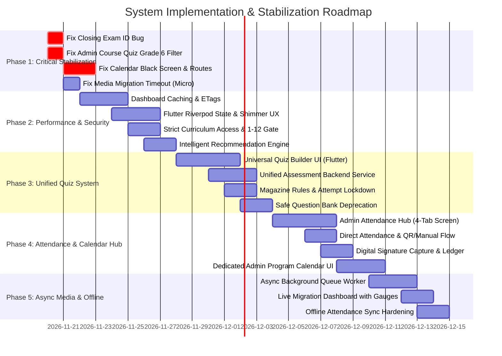

# IMPLEMENTATION ROADMAP & SEQUENTIAL EXECUTION PLAN
**Project:** Mezmur Zemseretee Hiwot (`MH-app-1.5.3`)  
**Phase:** Investigation & Technical Design Deliverable 4  
**Document Status:** Phased Technical Execution Plan & Verification Matrix  
**Timeline & Execution Scope:** 5 Structured Phases

---

## 1. Roadmap Overview & Strategic Phasing

The implementation roadmap is structured into 5 sequential phases designed to maximize stability, prevent regressions, and deliver high-impact user experience enhancements immediately. Each phase defines explicit dependencies, targeted file modifications, detailed testing protocols, and rollback contingencies.



---

## 2. Phase 1: Critical Bug Fixes & Urgent Stabilization

**Objective:** Instantly eliminate blocking runtime exceptions and navigation crashes without modifying complex database schemas.

### 2.1 Work Packages

#### WP 1.1: Fix Closing Exam "Assessment ID is required" Bug
* **Target Files:**
  - `mobile/mobile/lib/features/edu/learn/quizzes_admin.dart`
  - `laravel/routes/api/edu_learning.php`
  - `laravel/app/Mz/Services/EduQuizzes.php`
* **Implementation Actions:**
  1. In `quizzes_admin.dart` (line 122), update key extraction to support both `assessment_id` and `id`:
     ```dart
     final assessId = asInt(assess['assessment_id']) ?? asInt(assess['id']);
     ```
  2. In `routes/api/edu_learning.php` (line 263), return both keys:
     ```php
     return response()->json([
         'id' => $assessment->id,
         'assessment_id' => $assessment->id,
         'title' => $assessment->title,
     ]);
     ```
* **Success Criteria:** Creating a closing exam successfully saves without `ASSESSMENT_REQUIRED` error.

#### WP 1.2: Fix Class Course Quiz "Only Grade 6 Appears" Bug
* **Target Files:**
  - `mobile/mobile/lib/features/edu/learn/quizzes_admin.dart`
  - `laravel/app/Mz/Services/EduTeachers.php`
  - `laravel/routes/api/edu.php`
* **Implementation Actions:**
  1. In `quizzes_admin.dart` (lines 48–56), replace the strict call to `repo.teaching()` with an admin-aware call `repo.availableClassesAndCourses()`.
  2. In Laravel, expose `GET /api/v1/edu/quizzes/target-options`:
     - If user is admin: returns all active classes and courses across Grades 1–12.
     - If user is teacher: returns only courses where user is assigned instructor.
* **Success Criteria:** Administrators see all active grade classes (Grades 1 through 12) when creating a quiz.

#### WP 1.3: Fix Admin Program Calendar Black Screen & Layout Crash
* **Target Files:**
  - `mobile/mobile/lib/app/router.dart`
  - `mobile/mobile/lib/features/admin/programs_admin.dart`
  - `mobile/mobile/lib/features/programs/calendar/unified_calendar_screen.dart`
* **Implementation Actions:**
  1. In `router.dart`, register `/admin/programs/calendar` as a standalone subroute under `/admin/programs` outside the `StatefulShellBranch`.
  2. In `programs_admin.dart` (line 118), update navigation from `context.push('/programs/calendar')` to `context.push('/admin/programs/calendar')`.
  3. In `unified_calendar_screen.dart` (lines 540–610), remove the unconstrained nested `Expanded(child: GridView.builder)` and constrain it with a fixed `SliverGrid` or `TableCalendar` layout.
* **Success Criteria:** Tapping "Calendar" in Admin Programs opens instantly without black screen or unbounded layout errors.

#### WP 1.4: Fix Media Migration 30-Second Audio Timeout (Immediate Patch)
* **Target Files:**
  - `laravel/app/Mz/Services/MediaMigration.php`
  - `mobile/mobile/lib/core/config/app_config.dart`
  - `mobile/mobile/lib/features/admin/media_migration_screen.dart`
* **Implementation Actions:**
  1. In `media_migration_screen.dart`, add a query parameter `?limit=1` when running audio migration.
  2. In `MediaMigration.php`, limit audio file processing to 1 track per synchronous batch request to stay within 15 seconds.
  3. Increase Dio's `receiveTimeout` for the media client to 60,000ms.
* **Success Criteria:** Clicking "Run Batch" for audio files completes successfully without `ApiException(null, TIMEOUT, null)`.

---

## 3. Phase 2: Education Performance & Strict Curriculum Access

**Objective:** Accelerate Education page rendering, eliminate blocking spinners, enforce strict grade curriculum scoping, and generate intelligent curriculum-sequenced recommendations.

### 3.1 Work Packages

#### WP 2.1: Multi-Tier Caching & ETag Implementation (Backend)
* **Target Files:**
  - `laravel/app/Mz/Services/EduDashboard.php`
  - `laravel/app/Http/Controllers/Api/EduDashboardController.php`
  - `laravel/routes/api/edu.php`
* **Implementation Actions:**
  1. Wrap `EduDashboard::forUser` queries with `Cache::remember("edu:user:{$userId}:dashboard:v1", 900, ...)`.
  2. Implement ETag checking: Return HTTP 304 Not Modified if payload has not changed.
  3. Separate secondary feeds: Move magazine banner and library book carousel into independent asynchronous endpoints (`/edu/seleda-banner`, `/library/books/preview`).
  4. Register model event listeners to evict user dashboard cache on progress or quiz submissions.

#### WP 2.2: Stale-While-Revalidate & Skeleton Shimmer UI (Mobile)
* **Target Files:**
  - `mobile/mobile/lib/features/edu/learn/edu_home.dart`
  - `mobile/mobile/lib/features/edu/learn/progress_more.dart`
  - `mobile/mobile/lib/features/edu/learn/edu_dashboard_notifier.dart`
* **Implementation Actions:**
  1. Convert `eduDashboardProvider` from `.autoDispose` to a persistent `NotifierProvider` with local Hive persistence.
  2. Replace full-screen blocking `_HomeSkeletonLoading` with modular per-section skeleton shimmers:
     - Continue Learning shimmer (110dp card).
     - Subjects grid shimmer (3 horizontal cards).
     - Upcoming assessments shimmer (72dp card).
  3. Keep existing data visible during pull-to-refresh, showing only a 2dp top progress indicator.

#### WP 2.3: Strict Grade Curriculum Access Gate & Navigation Scoping
* **Target Files:**
  - `laravel/app/Mz/Services/EduLearning.php`
  - `mobile/mobile/lib/features/edu/learn/edu_home.dart`
  - `mobile/mobile/lib/features/edu/learn/learn_screens.dart`
  - `mobile/mobile/lib/app/router.dart`
* **Implementation Actions:**
  1. In `edu_home.dart`, delete the generic header `"Subject (Select a subject to browse grade curriculum 1 - 12)"`.
  2. Replace it with `"የእርስዎ የክፍል ትምህርቶች (Grade {grade} - {class})"` displaying only the student's assigned subjects.
  3. In `EduLearning.php` (`canOpen`), eliminate the permissive `visibility === 'members'` check. Enforce that students MUST belong to an active class enrolled in the subject.
  4. Add route guards in Flutter router to intercept out-of-grade URLs and display an `AccessDeniedCurriculumScreen`.

#### WP 2.4: Intelligent Curriculum-Aware Continue Learning Algorithm
* **Target Files:**
  - `laravel/app/Mz/Services/EduDashboard.php`
  - `laravel/app/Mz/Services/EduLearning.php`
  - `mobile/mobile/lib/features/edu/learn/progress_more.dart`
* **Implementation Actions:**
  1. Rewrite `EduDashboard::progress` to follow the formal 8-step algorithm:
     - Active class enrollment -> Assigned class courses -> Course sort order -> First incomplete lesson.
  2. In `EduLearning::studentAssignedClassSubjects`, replace hardcoded `'completed' => 0, 'percent' => 0` with real aggregate progress calculations.
  3. In `progress_more.dart`, render the explainable recommendation card with context tag: `"በክፍልህ ሥርዓተ-ትምህርት ቅደም-ተከተል መሠረት"`.

---

## 4. Phase 3: Unified Quiz Authoring System & Question Bank Deprecation

**Objective:** Consolidate all fragmented quiz forms into a reusable Universal Quiz Builder, enforce magazine quiz rules, and safely deprecate legacy question banks.

### 4.1 Work Packages

#### WP 3.1: Build Universal Quiz Builder Screen (Flutter)
* **Target Files:**
  - `mobile/mobile/lib/features/edu/learn/unified_quiz_editor_screen.dart` (New File)
  - `mobile/mobile/lib/features/edu/learn/quizzes_admin.dart`
  - `mobile/mobile/lib/features/edu/learn/magazine_admin.dart`
* **Implementation Actions:**
  1. Create `UnifiedQuizEditorScreen` with 3 clean tabs:
     - Tab 1: General Info & Target Context (Magazine, Closing Exam, Course Quiz, Lesson Quiz).
     - Tab 2: Question List & Builder (Multiple Choice, True/False, marks, explanations, reordering, duplicate).
     - Tab 3: Rules & Settings (Time limit, max attempts, start/close dates, immediate results).
  2. Replace `EduMagazineQuizEditorDialog` in `magazine_admin.dart` with navigation to `UnifiedQuizEditorScreen(context: QuizContext.magazine)`.

#### WP 3.2: Enforce Magazine Quiz Business Rules
* **Target Files:**
  - `laravel/app/Mz/Services/EduQuizzes.php`
  - `mobile/mobile/lib/features/edu/learn/unified_quiz_editor_screen.dart`
  - `mobile/mobile/lib/features/edu/learn/quiz_screens.dart`
* **Implementation Actions:**
  1. When quiz context is `magazine`:
     - Max attempts is hardcoded to `1` (single attempt competition).
     - Closing date defaults to `starts_at + 7 days` (exactly 168 hours).
  2. Before a student enters a magazine quiz, verify that the corresponding magazine PDF/issue has been viewed/downloaded.

#### WP 3.3: Safe Deprecation of Question Bank (F12)
* **Target Files:**
  - `mobile/mobile/lib/features/edu/learn/quizzes_admin.dart`
  - `laravel/app/Mz/Services/EduQuizzes.php`
  - `laravel/routes/api/edu.php`
* **Implementation Actions:**
  1. Remove `_openQuestionBanks()` and `_QuestionBanksSheet` from `quizzes_admin.dart`.
  2. In `EduQuizzes::start()`, remove `edu_quiz_draws` lookup; load direct questions exclusively from `edu_quiz_questions`.
  3. Mark API routes in `routes/api/edu.php` for bank management as deprecated (HTTP 410 Gone for write actions).
  4. Ensure existing rows in `edu_quiz_attempts` and `edu_quiz_answers` are preserved without alteration.

---

## 5. Phase 4: Admin Attendance Hub & Program Calendar Management

**Objective:** Create a unified, intuitive administrative attendance dashboard, add direct QR/manual attendance workflows, integrate digital signatures, and establish calendar occurrence controls.

### 5.1 Work Packages

#### WP 4.1: Unified Admin Attendance Hub Screen (Flutter)
* **Target Files:**
  - `mobile/mobile/lib/features/admin/attendance/admin_attendance_hub_screen.dart` (New File)
  - `mobile/mobile/lib/features/admin/attendance_management_screen.dart`
  - `mobile/mobile/lib/features/admin/admin_home.dart`
* **Implementation Actions:**
  1. Create a 4-tab administrative hub:
     - Tab 1: Overview & Quick Action (Today's statistics, pending alerts, program picker).
     - Tab 2: Manual Rosters & Taking Sheet.
     - Tab 3: Permission Requests & Corrections Inbox.
     - Tab 4: Digital Signatures Ledger & History.
  2. Add prominent `"👥 አቴንዳንስ መዝግብ (Take Attendance)"` quick-action button on the Admin Home page.

#### WP 4.2: Direct Attendance & QR/Manual Workflow
* **Target Files:**
  - `mobile/mobile/lib/features/admin/attendance/attendance_taking_sheet.dart` (New File)
  - `mobile/mobile/lib/features/admin/attendance_take.dart`
  - `laravel/app/Mz/Services/Attendance.php`
* **Implementation Actions:**
  1. Allow instant toggle between QR Code Camera Scanner (with beep audio feedback) and Manual Roster.
  2. Manual roster displays student profile photos, roll numbers, and 4 one-tap status chips (Present, Late, Absent, Excused).
  3. Add "Mark All Present" batch action for fast recording.

#### WP 4.3: Digital Signature Capture & Secure Storage
* **Target Files:**
  - `mobile/mobile/lib/features/admin/attendance/signature_pad_dialog.dart` (New File)
  - `laravel/app/Mz/Services/Attendance.php`
  - `laravel/app/Http/Controllers/Api/AttendanceController.php`
* **Implementation Actions:**
  1. Implement Flutter signature canvas allowing teachers/supervisors to sign directly upon finishing attendance.
  2. In Laravel, write signature files to `storage/app/signatures/{year}/{session_id}_{signer_id}.png`.
  3. Save path in `attendance_sessions.supervisor_signature_path` with encrypted permission access.

#### WP 4.4: Dedicated Admin Program Calendar UI
* **Target Files:**
  - `mobile/mobile/lib/features/admin/programs/admin_program_calendar_screen.dart` (New File)
  - `mobile/mobile/lib/features/admin/programs_admin.dart`
  - `laravel/app/Mz/Services/Programs.php`
* **Implementation Actions:**
  1. Build administrative calendar screen with month/agenda view.
  2. Each program occurrence card features:
     - Occurrence time, location, assigned leader, and status pill.
     - Direct button: `[👥 አቴንዳንስ ውሰድ (Take Attendance)]` pre-filling program and date.
     - Administrative status dropdown (`Draft`, `Scheduled`, `In Progress`, `Completed`, `Cancelled`).

---

## 6. Phase 5: Resilient Media Migration & Offline Enhancements

**Objective:** Implement background asynchronous media processing, real-time visual progress monitoring, and resilient offline attendance synchronization.

### 6.1 Work Packages

#### WP 5.1: Background Media Queue Job & Micro-Batching
* **Target Files:**
  - `laravel/app/Jobs/ProcessMediaItemMigrationJob.php` (New File)
  - `laravel/app/Mz/Services/MediaMigration.php`
  - `laravel/app/Http/Controllers/Api/MediaMigrationController.php`
* **Implementation Actions:**
  1. Create queued job `ProcessMediaItemMigrationJob` with 180s process execution timeout per track.
  2. Implement Redis hash storage for live session counters: `total`, `processed`, `completed`, `failed`, `bytes_saved`.
  3. Retain micro-batching endpoint (`limit=1`) as fallback for non-queue environments.

#### WP 5.2: Real-Time Migration Control Hub UI
* **Target Files:**
  - `mobile/mobile/lib/features/admin/media_migration_screen.dart`
* **Implementation Actions:**
  1. Add overall progress bar (0–100%) and space-saved storage gauge (GB saved / % reduced).
  2. Implement 2.5-second polling of `/api/v1/media-migration/status/{job_id}`.
  3. Add failed items list with exact error message dialog and one-click "Retry Failed Items" button.

#### WP 5.3: Offline SQLite Attendance Synchronization Hardening
* **Target Files:**
  - `mobile/mobile/lib/features/admin/attendance/offline_attendance_store.dart` (New File)
  - `laravel/app/Mz/Services/Attendance.php`
* **Implementation Actions:**
  1. Store local attendance entries with client ISO timestamps in mobile SQLite.
  2. On reconnect, post batch to `/api/v1/attendance/sync-offline`.
  3. Implement Server-Timestamp-Wins conflict resolution with audit logging in `attendance_sync_conflicts`.

---

## 7. Verification Protocols & Test Matrices

### 7.1 Automated & Unit Test Plan
| Phase | Test Scope | Tool / Framework | Target Benchmark |
| :--- | :--- | :--- | :--- |
| **Phase 1** | Assessment ID response mapping & Class discovery | PHPUnit / Laravel Test | 100% pass on quiz creation payloads |
| **Phase 1** | GoRouter Admin Calendar route navigation | Flutter Widget Tests | Zero black screen exceptions |
| **Phase 2** | Dashboard ETag 304 response & Redis caching | Pest / PHPUnit | Dashboard response time < 80ms on cache hit |
| **Phase 2** | Strict curriculum access rules (`canOpen`) | PHPUnit Role Tests | Grade 7 user receives 403 on Grade 8 endpoints |
| **Phase 2** | 8-Step recommendation sequence logic | PHPUnit Unit Tests | Returns exact next incomplete lesson in order |
| **Phase 3** | Magazine quiz 1-attempt & 7-day window rules | Pest / PHPUnit | Attempt 2 rejected; expiry set to exactly 168h |
| **Phase 4** | Attendance signature upload & session linking | PHPUnit File Tests | Signature file written to disk & DB updated |
| **Phase 5** | Queue worker timeout & FFmpeg transcode | Integration Tests | Zero Dio timeouts on 50MB audio files |

### 7.2 Manual Acceptance Criteria Checklist
- [ ] **Closing Exam Creation:** Admin opens Closing Exam dialog, fills form, clicks Save -> Quiz created with zero validation errors.
- [ ] **Admin Quiz Class Selection:** Admin opens Class Course Quiz form -> Dropdown lists Grade 1 through Grade 12 classes.
- [ ] **Calendar Navigation:** Admin taps Calendar in Admin Programs -> Calendar opens immediately, renders occurrences, and allows tapping "Take Attendance".
- [ ] **Education Home Speed:** Student logs in -> Dashboard renders cached view in < 50ms, shows subtle shimmer on refresh, never blocks entire screen.
- [ ] **Overall Progress Recommendation:** Grade 7 student opens Overall Progress -> Recommends Grade 7 Doctrine Chapter 2 (NOT Grade 1).
- [ ] **Strict Curriculum Access:** Grade 7 student cannot see Grade 1–12 browse header; attempting to open Grade 9 URL is blocked with friendly access message.
- [ ] **Unified Quiz Authoring:** Admin creates a magazine quiz -> System enforces 1 attempt and 7-day closing date automatically.
- [ ] **Media Migration Progress:** Admin starts audio migration -> Live progress bar updates every 2.5s; space saved is displayed; zero timeout crashes.
- [ ] **Take Attendance Hub:** Admin taps "Take Attendance" on dashboard -> Quickly toggles QR/Manual, marks students, captures teacher signature, and submits.

*(Next Deliverable: `project-docs/deliverables/Risk_and_Compatibility_Report.md`)*
