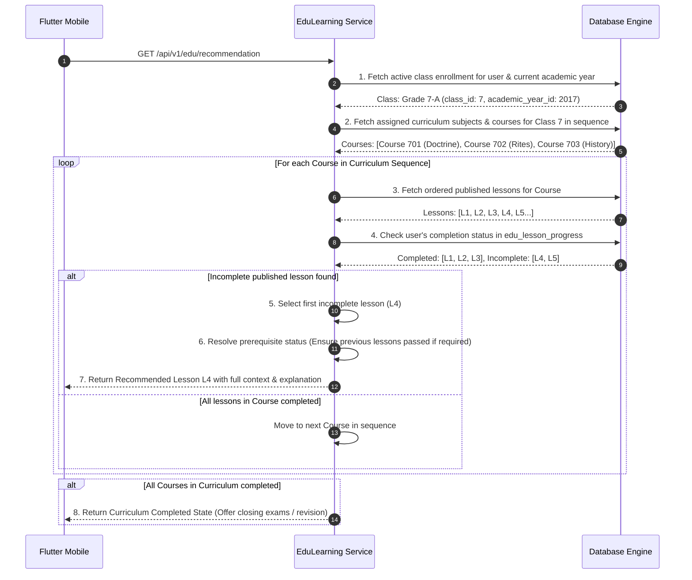
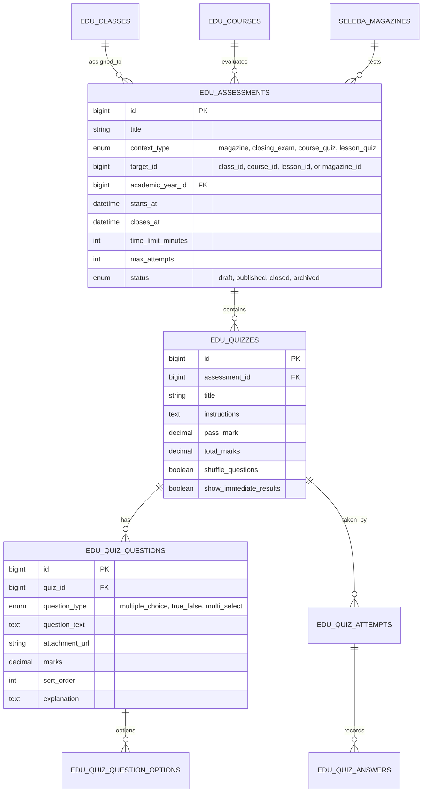
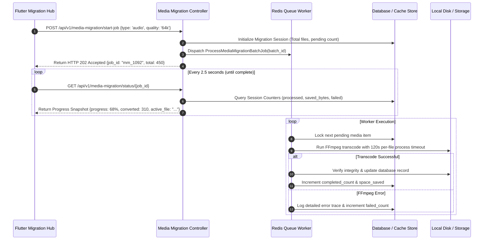

# PROPOSED FUNCTIONAL ARCHITECTURE & TECHNICAL SPECIFICATION
**Project:** Mezmur Zemseretee Hiwot (`MH-app-1.5.3`)  
**Phase:** Investigation & Technical Design Deliverable 3  
**Document Status:** Complete Technical Architecture & Specification  
**Target Systems:** Laravel Backend (APIs, Services, Database) & Flutter Mobile App (Riverpod, Dio, Offline Engine)

---

## 1. System Overview & Architectural Objectives

This document establishes the end-to-end technical and functional architecture to resolve performance degradation, authorization leaks, workflow fragmentation, and task timeouts across the educational and administrative subsystems.

```mermaid
graph TD
    subgraph Client Application (Flutter Mobile)
        UI[Mobile UI Screens]
        RP[Riverpod State Layer<br/>(Cache-First / Stale-While-Revalidate)]
        NC[Network Client (Dio + ETag Interceptor)]
        LS[Local Storage (Hive & SQLite Offline Store)]
    end

    subgraph API Gateway & Routing (Laravel 11)
        RT[API Routes (api/v1/edu, programs, media)]
        MW[Auth Middleware (Sanctum + Tenant/Role Checks)]
        RG[Curriculum Authorization Guard]
    end

    subgraph Application Services
        EDS[EduDashboard Service]
        ELS[EduLearning & Recommendation Service]
        EQS[EduQuizzes & Unified Assessment Service]
        ATS[Attendance & Signature Service]
        MMS[Media Migration Background Service]
    end

    subgraph Data & Storage Layer
        DB[(PostgreSQL / MySQL Main DB)]
        RC[(Redis Cache & Queue Store)]
        FS[Disk Storage (Audio, Transcodes, Signatures)]
    end

    UI --> RP
    RP --> LS
    RP --> NC
    NC --> RT
    RT --> MW
    MW --> RG
    RG --> EDS
    RG --> ELS
    RG --> EQS
    RG --> ATS
    RG --> MMS

    EDS --> RC
    EDS --> DB
    ELS --> DB
    EQS --> DB
    ATS --> DB
    ATS --> FS
    MMS --> RC
    MMS --> DB
    MMS --> FS
```

---

## 2. Education Module Loading & Caching Architecture

### 2.1 Problem Analysis & Bottlenecks
During forensic profiling of `EduDashboard::forUser`, the following critical performance flaws were documented:
1. **Zero Caching:** Every invocation runs 18+ complex SQL queries regardless of whether curriculum data has changed.
2. **N+1 Query Cascades:** Query loops over active enrollments, course teachers, unread announcements, and unsubmitted homework items execute serially.
3. **Payload Bloat:** The endpoint returns 40KB+ payloads containing canonical subjects, detailed chapter trees, unread notifications, library books preview, and magazine banners in a single synchronous block.
4. **Client-Side Disposal:** Flutter's `eduDashboardProvider` utilizes `.autoDispose`, wiping loaded state whenever the student taps into a lesson or drawer, forcing a cold fetch on return.

### 2.2 Optimized Backend Architecture & Query Strategy

#### A. Multi-Tier Caching Strategy (`Cache::remember`)
We introduce a 3-tier caching model in `EduDashboard`:

```
Tier 1: Static Curriculum Metadata (TTL: 24 Hours)
        Keys: edu:curriculum:class:{class_id}:v1
        Data: Subjects, courses, chapters, lesson counts, sort orders.

Tier 2: Student Progress & Enrollment Context (TTL: 15 Minutes or Event-Invalidated)
        Keys: edu:user:{user_id}:dashboard:v1
        Data: Enrolled class, current course, lesson progress, attendance stats.

Tier 3: Dynamic Feeds (TTL: 5 Minutes)
        Keys: edu:user:{user_id}:announcements:v1, edu:magazine:latest:v1
```

#### B. Cache Invalidation Triggers (Event-Driven)
The dashboard cache for a user is evicted immediately upon state-changing events:
* `LessonCompletedEvent` -> `Cache::forget("edu:user:{$userId}:dashboard:v1")`
* `QuizSubmittedEvent` -> `Cache::forget("edu:user:{$userId}:dashboard:v1")`
* `ClassEnrollmentChangedEvent` -> `Cache::forget("edu:user:{$userId}:*")`
* `CurriculumUpdatedEvent` -> `Cache::tags(['curriculum'])->flush()`

#### C. ETag / HTTP Conditional Requests (`304 Not Modified`)
The API gateway implements HTTP `If-None-Match` and `ETag` generation:
```php
// In EduDashboardController.php
public function dashboard(Request $request)
{
    $userId = $request->user()->id;
    $cacheKey = "edu:user:{$userId}:dashboard:v1";
    $etag = md5($cacheKey . Cache::get("edu:user:{$userId}:last_updated", 'initial'));

    if ($request->header('If-None-Match') === $etag) {
        return response(null, 304);
    }

    $data = Cache::remember($cacheKey, 900, function () use ($userId) {
        return EduDashboard::forUser($userId);
    });

    return response()->json($data)
        ->header('ETag', $etag)
        ->header('Cache-Control', 'private, max-age=300, must-revalidate');
}
```

#### D. Decoupling Secondary Dashboard Feeds
Instead of packing everything into one heavy response, decouple non-critical feeds:
1. `GET /api/v1/edu/dashboard` -> Core dashboard only (Active enrollment, continue learning, assigned class subjects, upcoming assessments).
2. `GET /api/v1/edu/seleda-banner` -> Cached globally per magazine release.
3. `GET /api/v1/library/books?domain=timhirt` -> Cached independently with pagination.

### 2.3 Mobile State Management Redesign (Riverpod)

```dart
// Mobile: lib/features/edu/learn/edu_dashboard_notifier.dart
@Riverpod(keepAlive: true)
class EduDashboardNotifier extends _$EduDashboardNotifier {
  @override
  FutureOr<EduDashboardData> build() async {
    // 1. Instantly return cached state from Hive if available
    final cached = await _loadFromLocalStorage();
    if (cached != null) {
      state = AsyncData(cached);
      // Trigger silent background revalidation if stale (> 5 minutes)
      if (_isStale(cached)) {
        _refreshInBackground();
      }
      return cached;
    }
    // 2. Cold fetch if no local cache exists
    return _fetchFromApi();
  }

  Future<void> refresh() async {
    // Maintain existing data while refreshing (no full-screen spinner!)
    state = AsyncLoading<EduDashboardData>().copyWithPrevious(state);
    try {
      final fresh = await _fetchFromApi();
      await _saveToLocalStorage(fresh);
      state = AsyncData(fresh);
    } catch (e, st) {
      state = AsyncError(e, st).copyWithPrevious(state);
    }
  }
}
```

---

## 3. Intelligent Continue Learning Recommendation Architecture

### 3.1 Problem Root Cause
In `EduDashboard::progress` (lines 395–408 of `EduDashboard.php`), the current query is:
```sql
-- CURRENT BROKEN QUERY:
SELECT l.*, s.title as subject_title 
FROM edu_lessons l
JOIN edu_subjects s ON l.subject_id = s.id
WHERE l.id NOT IN (SELECT lesson_id FROM edu_lesson_progress WHERE user_id = ?)
ORDER BY s.sort_order ASC, l.sort_order ASC 
LIMIT 1;
```
This query completely ignores class enrollments and curriculum assignments! It selects the first lesson in the database from Subject 1 (Grade 1 doctrine), recommending it to every student regardless of grade.

### 3.2 Formal 8-Step Recommendation Algorithm



### 3.3 Optimized SQL Implementation

```sql
-- Step 1: Active Enrollment
WITH active_class AS (
    SELECT c.id as class_id, c.grade_level, c.academic_year_id
    FROM edu_class_students cs
    JOIN edu_classes c ON cs.class_id = c.id
    WHERE cs.student_id = :user_id 
      AND cs.status = 'active'
      AND c.is_active = 1
    ORDER BY cs.created_at DESC
    LIMIT 1
),
-- Step 2: Curriculum Courses in Order
curriculum_courses AS (
    SELECT 
        cc.course_id, 
        cc.sort_order as course_order,
        c.title as course_title,
        s.title as subject_title
    FROM edu_class_courses cc
    JOIN active_class ac ON cc.class_id = ac.class_id
    JOIN edu_courses c ON cc.course_id = c.id
    JOIN edu_subjects s ON c.subject_id = s.id
    WHERE c.status = 'published'
    ORDER BY cc.sort_order ASC
),
-- Step 3: All Published Lessons with Progress
lesson_candidates AS (
    SELECT 
        l.id as lesson_id,
        l.title as lesson_title,
        l.course_id,
        l.sort_order as lesson_order,
        cc.course_order,
        cc.course_title,
        cc.subject_title,
        lp.status as progress_status,
        lp.progress_percent
    FROM edu_lessons l
    JOIN curriculum_courses cc ON l.course_id = cc.course_id
    LEFT JOIN edu_lesson_progress lp 
        ON l.id = lp.lesson_id AND lp.user_id = :user_id
    WHERE l.status = 'published'
)
-- Step 4: Pick the very first incomplete or in-progress lesson
SELECT * FROM lesson_candidates
WHERE progress_status IS NULL OR progress_status != 'completed'
ORDER BY course_order ASC, lesson_order ASC
LIMIT 1;
```

### 3.4 Handling Complex Edge Cases
* **Prerequisites & Locked Lessons:** If a lesson is locked because the previous lesson's quiz is required, the recommendation flags `is_locked: true` and points to the prerequisite quiz: `"ምዕራፍ 2 ፈተናን ማለፍ ያስፈልጋል"`.
* **Reordered Curriculum:** Sorting uses explicit `cc.sort_order` from the class-course relationship table, ensuring that administrative adjustments to syllabus order immediately reflect in recommendations.
* **Unpublished Lessons:** Lessons with `status != 'published'` are strictly excluded, preventing ghost recommendations.

---

## 4. Strict Curriculum Access Control & Security Model

### 4.1 Multi-Tier Enforcement Matrix

```
+---------------------------------------------------------------------------------------+
| LAYER 1: CLIENT-SIDE NAVIGATION (Flutter Router & Guards)                              |
| Intercepts direct URL routing, deep links, and UI clicks. Scopes UI to active class.  |
+---------------------------------------------------------------------------------------+
                                           │
                                           ▼
+---------------------------------------------------------------------------------------+
| LAYER 2: CONTROLLER & MIDDLEWARE AUTHORIZATION (Laravel Sanctum + Policy)             |
| Validates request headers and asserts user ownership / class assignment.              |
+---------------------------------------------------------------------------------------+
                                           │
                                           ▼
+---------------------------------------------------------------------------------------+
| LAYER 3: SERVICE LAYER AUTHORIZATION (`EduLearning::canOpen`)                         |
| Checks grade level match, active enrollment, and teacher/admin overrides.             |
+---------------------------------------------------------------------------------------+
                                           │
                                           ▼
+---------------------------------------------------------------------------------------+
| LAYER 4: DATABASE SCOPING (Query Constraints)                                          |
| All queries for lessons, materials, and quizzes MUST join `edu_class_courses`.        |
+---------------------------------------------------------------------------------------+
                                           │
                                           ▼
+---------------------------------------------------------------------------------------+
| LAYER 5: DOWNLOAD & MEDIA SECURITY (Temporary Signed URLs)                            |
| Audio streams and PDF downloads generate 15-minute cryptographically signed URLs.     |
+---------------------------------------------------------------------------------------+
```

### 4.2 Updating `EduLearning::canOpen`
The root cause of out-of-grade access was identified in `EduLearning.php` (line 94):
`if ($s->visibility === 'members') return true;`
Because canonical subjects defaulted to `members`, any registered member could access any grade!

#### Secure Implementation:
```php
// In EduLearning.php
public static function canOpen(User $user, EduSubject $subject): bool
{
    // 1. Super Admins, Education Directors, and Curriculum Editors have global read
    if ($user->hasAnyRole(['admin', 'edu_admin', 'curriculum_editor'])) {
        return true;
    }

    // 2. Teachers assigned to this subject or its courses
    if ($user->hasRole('teacher')) {
        $isAssignedTeacher = DB::table('edu_course_teachers ct')
            ->join('edu_courses c', 'ct.course_id', '=', 'c.id')
            ->where('ct.teacher_id', $user->id)
            ->where('c.subject_id', $subject->id)
            ->where('ct.status', 'active')
            ->exists();
        if ($isAssignedTeacher) return true;
    }

    // 3. Students: MUST have an active enrollment in a class assigned to this subject's grade
    $activeEnrollment = DB::table('edu_class_students cs')
        ->join('edu_classes c', 'cs.class_id', '=', 'c.id')
        ->join('edu_class_subjects cls', 'c.id', '=', 'cls.class_id')
        ->where('cs.student_id', $user->id)
        ->where('cs.status', 'active')
        ->where('c.is_active', 1)
        ->where('cls.subject_id', $subject->id)
        ->exists();

    if ($activeEnrollment) {
        return true;
    }

    // 4. Public general resources (e.g. general orientation or magazine)
    if ($subject->is_public && $subject->grade_level === null) {
        return true;
    }

    // Default: Strictly DENY access
    return false;
}
```

### 4.3 Handling Special User States
1. **Unenrolled Students:** `canOpen` returns `false` for all grade-specific subjects. The UI presents an unenrolled orientation screen directing the user to contact the Sunday school administration.
2. **Transferred Students:** If a student was transferred from Class 7-A to Class 7-B, the historical enrollment record has `status = 'transferred'`. The student has write/quiz access to 7-B and read-only access to completed records from 7-A.
3. **Historical Academic Years:** When viewing past academic years, a `HistoricalAcademicYearMiddleware` sets a read-only flag. Students can review lesson text and past quiz scores, but submission endpoints return `403 FORBIDDEN: ACADEMIC_YEAR_CLOSED`.
4. **Media Downloads:** Direct file URLs are replaced with route `/api/v1/edu/materials/{id}/download`, which checks `canOpen()` before streaming the file using `Storage::download()`.

---

## 5. Quizzes & Assessments Architecture & Unified Lifecycle

### 5.1 Database Entity Relationship Architecture



### 5.2 Resolution of Critical Bugs

#### A. Closing Exam: "Assessment ID is required" Bug
* **Cause in Code:** 
  1. Backend `routes/api/edu_learning.php` (line 247) returns:
     `return response()->json(['assessment_id' => $newId, ...]);`
  2. Frontend `quizzes_admin.dart` (line 122) extracts:
     `final assessId = asInt(assess['id']); // EVALUATES TO NULL!`
  3. Frontend sends `{assessment_id: null}` to `EduQuizzes::create()`, which throws `ASSESSMENT_REQUIRED`.
* **Permanent Fix:**
  In `quizzes_admin.dart`:
  ```dart
  // Robust ID extraction supporting both keys
  final assessId = asInt(assess['assessment_id']) ?? asInt(assess['id']);
  if (assessId == null || assessId <= 0) {
    throw StateError('Failed to resolve valid assessment identifier from backend.');
  }
  ```
  In `routes/api/edu_learning.php`:
  Normalize response payload to include both for total backward compatibility:
  ```php
  return response()->json([
      'id' => $assessment->id,
      'assessment_id' => $assessment->id,
      'title' => $assessment->title,
  ]);
  ```

#### B. Class Course Quiz: Only Grade 6 Display Bug
* **Cause in Code:**
  `quizzes_admin.dart` (line 49) populates courses using:
  `final list = await repo.teaching();`
  `GET /edu/teaching` filters courses where the logged-in user is explicitly registered in `edu_course_teachers`. An administrator who was assigned as an instructor to Grade 6 only received Grade 6 courses.
* **Permanent Fix:**
  Introduce an administrative course discovery endpoint:
  ```php
  // In EduQuizzesController.php
  public function availableTargetClasses(Request $request)
  {
      $user = $request->user();
      if ($user->hasAnyRole(['admin', 'edu_admin'])) {
          // Administrators see all active classes across grades 1-12
          return EduClasses::where('is_active', 1)->with('courses')->get();
      }
      // Teachers see only their assigned classes
      return EduTeachers::assignedClassesWithCourses($user->id);
  }
  ```

### 5.3 Unified Quiz Authoring Service

The unified service handles all assessment types through standard parameters:

```php
// In app/Mz/Services/EduQuizzes.php
public static function createUnifiedQuiz(User $creator, array $data): EduQuiz
{
    DB::beginTransaction();
    try {
        // 1. Enforce business rules per context
        if ($data['context_type'] === 'magazine') {
            $data['max_attempts'] = 1; // Strict rule: 1 attempt for magazine competition
            $data['starts_at'] = $data['starts_at'] ?? now();
            $data['closes_at'] = Carbon::parse($data['starts_at'])->addDays(7); // 7-day default
        }

        // 2. Create or link Assessment container
        $assessment = EduAssessment::create([
            'title' => $data['title'],
            'context_type' => $data['context_type'],
            'target_id' => $data['target_id'],
            'academic_year_id' => $data['academic_year_id'] ?? null,
            'starts_at' => $data['starts_at'],
            'closes_at' => $data['closes_at'],
            'time_limit_minutes' => $data['time_limit_minutes'] ?? 30,
            'max_attempts' => $data['max_attempts'] ?? 1,
            'status' => 'draft',
            'created_by' => $creator->id,
        ]);

        // 3. Create Quiz definition
        $quiz = EduQuiz::create([
            'assessment_id' => $assessment->id,
            'title' => $data['title'],
            'instructions' => $data['instructions'] ?? '',
            'pass_mark' => $data['pass_mark'] ?? 50.0,
            'shuffle_questions' => $data['shuffle_questions'] ?? true,
            'show_immediate_results' => $data['show_immediate_results'] ?? true,
        ]);

        // 4. Attach initial questions if provided
        if (!empty($data['questions'])) {
            self::syncQuestions($quiz->id, $data['questions']);
        }

        DB::commit();
        return $quiz;
    } catch (\Throwable $e) {
        DB::rollBack();
        throw $e;
    }
}
```

### 5.4 Safe Deprecation & Removal of Question Bank (F12)
Forensic audit confirmed that direct quiz questions use `quiz_id != null` and `bank_id = null`. Question banks are an isolated experimental sub-feature.

#### 3-Step Safe Deprecation Strategy:
1. **Step 1 (UI Disconnection):** Remove `_openQuestionBanks()` and `_QuestionBanksSheet` from `quizzes_admin.dart`. Remove question bank import/export actions from the quiz editor.
2. **Step 2 (API Deprecation):** Mark the 7 bank endpoints in `routes/api/edu.php` as `@deprecated` returning HTTP 410 Gone for write operations. In `EduQuizzes::start()`, eliminate the `edu_quiz_draws` lookup and always load direct questions from `edu_quiz_questions`.
3. **Step 3 (Data Preservation):** Do **NOT** drop tables `edu_question_banks` or delete historical question bank rows. Existing student attempt history and results in `edu_quiz_attempts` remain 100% intact because they link directly to question texts and options copied during attempts.

---

## 6. Resilient Media Migration Engine & Architecture

### 6.1 Problem Root Cause
In `MediaMigration::runBatch` (`app/Mz/Services/MediaMigration.php`), the backend attempts to process a synchronous batch of up to 20 media files in a single HTTP request:
* High-bitrate audio transcoding via FFmpeg (`exec(...)`) takes between 8 and 25 seconds *per audio track*.
* Two or three audio files cause the HTTP request execution time to reach 45+ seconds.
* Flutter’s Dio HTTP client has a strict 30-second timeout (`AppConfig.receiveTimeout = 30000ms`), causing the client to abort with `ApiException(null, TIMEOUT, null)`.

### 6.2 Architectural Solution: Async Queue Worker + Micro-Batching



### 6.3 Queue Job Implementation Details

```php
// In app/Jobs/ProcessMediaItemMigrationJob.php
class ProcessMediaItemMigrationJob implements ShouldQueue
{
    use Dispatchable, InteractsWithQueue, Queueable, SerializesModels;

    public $timeout = 180; // 3 minutes per job

    public function __construct(public int $mediaId, public string $sessionId) {}

    public function handle(): void
    {
        $media = MediaItem::findOrFail($this->mediaId);
        $cacheKey = "migration_session:{$this->sessionId}";

        try {
            Cache::put("{$cacheKey}:current", $media->file_name, 60);
            
            // Execute transcoding with dedicated process timeout
            $result = MediaProcessing::transcodeAudio($media, 'aac', 64);
            
            // Update session stats atomically
            Redis::hincrby($cacheKey, 'completed', 1);
            Redis::hincrby($cacheKey, 'bytes_saved', $result['bytes_saved']);
        } catch (\Throwable $e) {
            Redis::hincrby($cacheKey, 'failed', 1);
            Redis::rpush("{$cacheKey}:errors", json_encode([
                'file' => $media->file_name,
                'error' => $e->getMessage(),
                'time' => now()->toIso8601String()
            ]));
        }
    }
}
```

### 6.4 Fallback Micro-Batching for Shared Hosts
For environments where background Redis queue daemons are not running, the API supports a `micro-batch` mode:
* `POST /api/v1/media-migration/run-batch?limit=1`
* Processes exactly **one audio file per HTTP request** with a 15-second execution budget, guaranteeing the client will never exceed Dio's 30-second timeout.

---

## 7. End-to-End Admin Attendance Architecture

### 7.1 Consolidated Service Architecture

The backend `app/Mz/Services/Attendance.php` provides an extensive set of existing methods. The architecture unifies them into a clean administrative REST API:

```
Endpoint: POST /api/v1/attendance/sessions/create-or-find
          Resolves or initializes an attendance session for (program_id/class_id, date, schedule_id).

Endpoint: POST /api/v1/attendance/sessions/{id}/record-batch
          Accepts attendance roster updates (array of student statuses: present, late, absent, excused).

Endpoint: POST /api/v1/attendance/sessions/{id}/signature
          Attaches supervisor/teacher digital signature (base64 SVG/PNG) to session record.

Endpoint: GET  /api/v1/attendance/permission-requests/pending
          Returns pending student absence requests for admin review.

Endpoint: POST /api/v1/attendance/permission-requests/{id}/review
          Approves or denies permission requests with admin notes.

Endpoint: POST /api/v1/attendance/corrections/submit
          Allows teachers/students to submit attendance correction requests with audit reasons.
```

### 7.2 Digital Signature Storage Architecture
1. The Flutter signature pad exports a clean SVG or PNG string.
2. The payload is sent to `POST /api/v1/attendance/sessions/{id}/signature`.
3. The server validates the image format, writes the file to protected disk storage:
   `storage/app/signatures/{year}/{session_id}_{signer_id}_{timestamp}.png`
4. The database path is recorded in `attendance_sessions.supervisor_signature_path`.
5. Access to retrieve signatures requires `manage_attendance` permission, preventing unauthorized public access.

### 7.3 Offline Attendance Sync Engine (SQLite to Backend)
For Sunday school locations with poor network connectivity:
1. **Local SQLite Ledger:** Attendance marks are written locally to mobile SQLite `local_attendance_records` with sync status `pending`.
2. **Conflict Resolution Strategy (Server-Timestamp Wins):**
   When the device reconnects to Wi-Fi/4G:
   - Mobile sends batch of pending records with `recorded_at` timestamps.
   - If a record was already marked on the server, the server compares timestamps. If the offline record is newer, it updates the status; otherwise, it records the conflict in the audit table and maintains server truth.
   - Return sync summary to client and update SQLite status to `synced`.

---

## 8. Admin Program Calendar Architecture

### 8.1 GoRouter Navigation Architecture Fix
* **Current Bug:** `/admin/programs` attempts to navigate to `/programs/calendar` using `context.push('/programs/calendar')`. Because `/programs/calendar` is defined inside a `StatefulShellBranch`, pushing from the root navigator corrupts the shell state, causing a black screen.
* **Architecture Fix:** Define `/admin/programs/calendar` as an independent top-level subroute of `/admin`:

```dart
// mobile/mobile/lib/app/router.dart
GoRoute(
  path: '/admin/programs',
  builder: (context, state) => const ProgramsAdminScreen(),
  routes: [
    GoRoute(
      path: 'calendar',
      builder: (context, state) => const AdminProgramCalendarScreen(),
    ),
  ],
),
```

### 8.2 Calendar Data Pipeline & Query Performance
To avoid loading an entire year's occurrences at once:
* Endpoint `GET /api/v1/programs/occurrences` accepts query parameters: `start_date` and `end_date` (defaulting to current month ± 1 week).
* Backend indexes `programs_schedules(start_date, end_date, is_active)`.
* Returns structured occurrence objects containing:
  - `id`, `program_id`, `program_title`, `location`, `starts_at`, `ends_at`, `status`, `assigned_leader_name`, `attendance_session_id`.
  - Enables direct one-tap transition from calendar occurrence card directly to attendance session taking.

---

## 9. Architectural Summary of Component Interfaces

| Subsystem | Primary Controller / Route | Service Layer Class | Cache & Storage Strategy |
| :--- | :--- | :--- | :--- |
| **Education Dashboard** | `EduDashboardController@dashboard` | `app/Mz/Services/EduDashboard.php` | Redis Cache (15 min) + ETags + Cache Tagging |
| **Continue Learning** | `EduLearningController@recommendation` | `app/Mz/Services/EduLearning.php` | Curriculum-sequenced SQL + Class Enrollment Scoping |
| **Curriculum Access** | `EduLearningController@subjectLessons` | `EduLearning::canOpen()` | Strict 5-tier role & class enrollment gate |
| **Unified Quiz Builder** | `EduQuizzesController@storeUnified` | `app/Mz/Services/EduQuizzes.php` | Context-sensitive validation (7-day, 1-attempt rules) |
| **Media Migration** | `MediaMigrationController@startJob` | `app/Mz/Services/MediaMigration.php` | Redis Queue Job + 1-by-1 micro-batch fallback |
| **Admin Attendance** | `AttendanceAdminController@*` | `app/Mz/Services/Attendance.php` | SQLite offline cache + Encrypted SVG/PNG signatures |
| **Admin Calendar** | `ProgramsAdminController@calendar` | `app/Mz/Services/Programs.php` | Date-ranged window queries + GoRouter subroute |

*(Next Deliverable: `project-docs/deliverables/Implementation_Roadmap.md`)*
