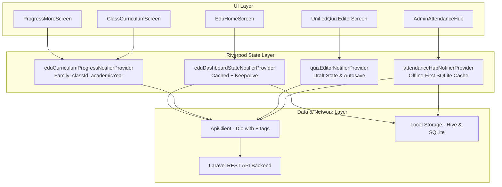

# PROPOSED UI/UX ARCHITECTURE & DESIGN SPECIFICATION
**Project:** Mezmur Zemseretee Hiwot (`MH-app-1.5.3`)  
**Phase:** Investigation & Technical Design Deliverable 2  
**Document Status:** Complete Architecture & Design Specification  
**Target Modules:** Education (Home & Progress), Strict Curriculum Navigation, Unified Quiz Builder, Admin Program Calendar, Resilient Media Migration, and Admin Attendance Hub.

---

## 1. Executive Summary & Design Principles

The Mezmur Zemseretee Hiwot mobile application serves students, teachers, deacons, choir members, and administrators across spiritual education, sacramental programs, and media distribution. The current user interface suffers from six primary usability bottlenecks identified during the forensic audit:
1. **Blocking Full-Screen Loading States:** The entire Education Home and Overall Progress screens freeze on a generic loading spinner, preventing students from accessing previously fetched or available sections.
2. **Context-Blind Recommendations & Leaked Navigation:** Students in specific grades (e.g., Grade 7) see irrelevant lesson recommendations and are invited to browse all Grade 1–12 curricula.
3. **Fragmented & Broken Assessment Interfaces:** Quiz creation is split between a limited dialog for magazines and a course quiz screen blocked by a missing ID bug (`Assessment ID is required`), with confusing legacy Question Bank features.
4. **Calendar Black Screen & Missing Controls:** The Admin Program calendar crashes upon navigation due to shell branch conflicts and lacks administrative scheduling controls.
5. **Opaque Media Migration:** Admins face 30-second timeout crashes with no real-time status indicators or background progress.
6. **Disjointed Attendance Management:** Taking attendance is buried behind deep, disconnected screens, missing direct manual/QR workflows and integrated signature review.

### Core Design Principles
* **Progressive Availability:** No single slow section blocks the rest of the application. High-priority content renders first; independent sections load asynchronously using skeleton shimmer placeholders.
* **Cached-First Rendering (Stale-While-Revalidate):** Previously cached data remains visible and interactive immediately while fresh updates fetch in the background.
* **Curriculum Context Scoping:** The student’s assigned class and academic year define the boundary of what is rendered. No student is exposed to out-of-grade curricula or unassigned subjects.
* **Unified Component Reusability:** Assessment authoring, attendance taking, and calendar interactions share standardized, modular components across educational and administrative domains.
* **Graceful Degradation & Network Resilience:** Every screen provides meaningful offline states, clear retry mechanisms, and non-intrusive error banners.

---

## 2. Education Module UI/UX Redesign

### 2.1 Education Home Screen (`EduHomeScreen`)

#### Current Problem vs. Redesigned Experience
* **Current:** Shows a full-screen blocking `_HomeSkeletonLoading` widget displaying `"Loading your education data..."`. Redundant requests re-fetch library books and magazine banners.
* **Redesigned:** Fast-rendered modular layout where the Header and Active Class Selector appear instantly from local cache. Each section (Continue Learning, Current Subjects, Quizzes & Assignments, Library Books, Magazine) renders its own scoped shimmer placeholder and updates independently.

#### Component Breakdown & Wireframe
```
+-------------------------------------------------------------+
| [Avatar] ሰላም ለኪ, ዮሐንስ (Grade 7 - A)           [🔔] [Search] |
| 📅 2017 ዓ.ም. | 1ኛ መንፈቀ ዓመት (Term 1)                       |
+-------------------------------------------------------------+
| 🚀 ቀጥል ተማር (CONTINUE LEARNING)                              |
| +---------------------------------------------------------+ |
| | [Subject Icon] ትምህርተ ሃይማኖት (Doctrine)                | |
| | ምዕራፍ 2: ነገረ ድኅነት (Chapter 2: Soteriology)           | |
| | ትምህርት 3: የሰው ልጅ መፈጠር እና ውድቀት                 | |
| | Progress: [████████████░░░░░░░] 68% Completed           | |
| | [▶ ትምህርቱን ቀጥል (Resume Lesson)]   [ዝርዝር (Details)]     | |
| +---------------------------------------------------------+ |
+-------------------------------------------------------------+
| 📚 የክፍልህ የትምህርት ዓይነቶች (YOUR CLASS SUBJECTS)               |
| [All Subjects (6)]                                          |
| +---------------+ +---------------+ +---------------+       |
| | ትምህርተ ሃይማኖት  | | ሥርዓተ ቤተክርስቲያን| | ታሪከ ቤተክርስቲያን  |       |
| | 8/12 Lessons  | | 4/10 Lessons  | | 10/10 Done ✅  |       |
| | [██████░░] 66%| | [████░░░░] 40%| | [████████] 100% |       |
| +---------------+ +---------------+ +---------------+       |
+-------------------------------------------------------------+
| 📝 የሚጠበቁ ፈተናዎች እና የቤት ሥራዎች (UPCOMING ASSESSMENTS)       |
| +---------------------------------------------------------+ |
| | ⏱️ ትምህርተ ሃይማኖት - ምዕራፍ 2 ማጠቃለያ ፈተና                | |
| | ቀሪ ጊዜ: 2 ቀናት | ሙከራ: 1/2 | 20 ጥያቄዎች (20 Marks)       | |
| | [ፈተናውን ጀምር (Start Assessment)]                        | |
| +---------------------------------------------------------+ |
+-------------------------------------------------------------+
| 📖 የትምህርት መጻሕፍት እና መጽሔት (STUDY MATERIALS & MAGAZINE)   |
| [የሰሌዳ መጽሔት ቁጥር 14 - ኅዳር 2017] [📖 አንብብ] [📝 ፈተና ውሰድ]  |
| [Horizontal Book Carousel: Grade 7 Textbooks & References]  |
+-------------------------------------------------------------+
```

#### Detailed State & Interaction Specifications
1. **Immediate Initial Paint (0-50ms):**
   - Reads cached user profile, active class enrollment (`class_id: 7`, `name: "Grade 7-A"`), and last-viewed course from Hive/secure storage.
   - Renders Top Header and cached Continue Learning card immediately without waiting for API response.
2. **Independent Section Loading States:**
   - **Continue Learning Card:** If cache is missing, displays a clean 110dp rounded shimmer container with icon and button outline.
   - **Subjects Grid:** Displays 3 horizontal shimmer tiles with rounded corners (160dp width).
   - **Upcoming Assessments:** Displays a 72dp high card shimmer.
3. **Pull-to-Refresh Behavior:**
   - Swipe down triggers a quiet background refresh (`ref.refresh(eduDashboardProvider)`).
   - **Crucial UX Fix:** The current UI remains 100% visible and interactive. A subtle top indeterminate linear progress bar (height 2dp) indicates active syncing.
4. **Offline & Error Recovery:**
   - If offline or backend error occurs during background refresh, a floating snackbar or non-intrusive top banner displays: `"ከመስመር ውጭ ነዎት (የቀደመ መረጃ እየታየ ነው) • [ደግመህ ሞክር]"`. Cached data remains completely accessible.

---

### 2.2 Overall Progress Screen (`ProgressMoreScreen`)

#### Current Problem vs. Redesigned Experience
* **Current:** Shows a blocking `"Loading progress data"` screen. Recommends random courses (often Grade 1 courses for Grade 7 students). Progress calculation is hardcoded to 0% in parts of the backend response.
* **Redesigned:** Instant progressive display showing real overall curriculum progress, explainable Continue Learning path strictly following Grade 7 sequence, and subject-by-subject expandable breakdown with individual lesson statuses (Completed, In Progress, Locked).

#### Component Breakdown & Wireframe
```
+-------------------------------------------------------------+
| [<- Back]              የትምህርት አጠቃላይ ውጤት               [Share]  |
|                       (Overall Learning Progress)           |
+-------------------------------------------------------------+
| 🎓 የክፍል አጠቃላይ ደረጃ (CURRICULUM OVERVIEW - GRADE 7)         |
| +---------------------------------------------------------+ |
| |              [  Circular Indicator  ]                   | |
| |                       64%                               | |
| |                   ተጠናቋል (Completed)                     | |
| |                                                         | |
| |  የተጠናቀቁ ትምህርቶች: 42      ቀሪ ትምህርቶች: 24                   | |
| |  የተወሰዱ ፈተናዎች: 8        አማካይ ውጤት: 86.5%                | |
| +---------------------------------------------------------+ |
+-------------------------------------------------------------+
| 🎯 ቀጣይ የሚመከር ትምህርት (EXPLAINABLE RECOMMENDED NEXT)           |
| +---------------------------------------------------------+ |
| | [💡 ለምን ተመረጠ? በክፍልህ ሥርዓተ-ትምህርት ቅደም-ተከተል መሠረት]  | |
| | የትምህርት ዓይነት: ትምህርተ ሃይማኖት (Doctrine)              | |
| | ምዕራፍ: ምዕራፍ 2: ነገረ ድኅነት                              | |
| | ቀጣይ ትምህርት: ትምህርት 4: የተስፋው ቃል እና ትንቢታት        | |
| | [ ▶ ትምህርቱን አሁን ጀምር (Start Lesson) ]                 | |
| +---------------------------------------------------------+ |
+-------------------------------------------------------------+
| 📑 የትምህርት ዓይነቶች ዝርዝር ሂደት (COURSE-BY-COURSE BREAKDOWN) |
|                                                             |
| ▼ 1. ትምህርተ ሃይማኖት (Grade 7 Doctrine)          8/12 [ 67% ] |
|   ├── ✔ ትምህርት 1: ሥነ-ፍጥረት                          (100%) |
|   ├── ✔ ትምህርት 2: የሰው ልጅ ክብር                      (100%) |
|   ├── ✔ ትምህርት 3: የሰው ልጅ ውድቀት                    (100%) |
|   ├── ⏳ ትምህርት 4: የተስፋው ቃል (Current)              ( 40%) |
|   └── 🔒 ትምህርት 5: ነገረ ማርያም በብሉይ ኪዳን           (Locked)|
|                                                             |
| ▶ 2. ሥርዓተ ቤተክርስቲያን (Church Rites)          4/10 [ 40% ] |
| ▶ 3. ታሪከ ቤተክርስቲያን (Church History)         10/10 [100% ✅]|
| ▶ 4. ግዕዝ ቋንቋ (Ge'ez Language Level 1)          2/8  [ 25% ] |
+-------------------------------------------------------------+
```

#### Detailed Recommendation Logic Presentation
* The recommendation card includes an explainability pill: `"በክፍልህ ሥርዓተ-ትምህርት ቅደም-ተከተል መሠረት"` (Based on your assigned class curriculum sequence).
* If all lessons in the current subject are complete, the card congratulates the student and points to the first lesson of the next assigned subject in the sequence.
* If the entire grade curriculum is 100% completed, the card transitions to a celebratory state:
  `"🎉 እንኳን ደስ አለዎት! የ7ኛ ክፍልን ሙሉ ሥርዓተ-ትምህርት አጠናቀዋል። ማጠቃለያ ፈተናዎችን ይውሰዱ ወይም የክለሳ ትምህርቶችን ይመልከቱ።"` (Congratulations! You have completed Grade 7 curriculum. Take closing exams or review lessons.)

---

## 3. Strict Curriculum Access Control & Class Navigation Redesign

### 3.1 Class Navigation & Header Correction

#### Current Flaw
`CanonicalCategoriesSection` in `edu_home.dart` displays:
`"Subject (Select a subject to browse grade curriculum 1 - 12)"`
Clicking opens `EduCategoryScreen`, which lists all canonical grades 1 through 12, allowing any student to jump into any grade's curriculum.

#### Redesigned Class Navigation
1. **Header Label Replacement:**
   - Replace generic label with: `"የእርስዎ የክፍል ትምህርቶች (Grade {grade_level} - {class_name})"`
   - Subtitle: `"በ2017 ዓ.ም. የተመዘገቡባቸው የትምህርት ዓይነቶች"` (Assigned curriculum subjects for academic year 2017 E.C.).
2. **Access Control View States:**
   - **State A: Active Student Enrollment (Standard):**
     - Renders *only* the subjects mapped to the student’s active class via `edu_class_subjects`.
     - Direct route access to other grades (e.g., `/edu/classes/9/curriculum` or deep link to a Grade 9 lesson) is intercepted by the route guard and redirected to an access-restricted screen.
   - **State B: Unenrolled User (No active class enrollment):**
     - Renders a friendly prompt:
       ```
       +---------------------------------------------------------+
       | ℹ️ የክፍል ምደባ አልተገኘም (No Class Enrollment)            |
       | በ2017 ዓ.ም. የትምህርት ዘመን በየትኛውም ክፍል ውስጥ አልተመደቡም።     |
       | እባክዎ የትምህርት አስተዳዳሪውን ወይም መምህርዎን ያነጋግሩ።           |
       | [የትምህርት አስተዳደርን አግኝ (Contact Admin)] [ክለሳ/ነፃ ይዘቶች]   |
       +---------------------------------------------------------+
       ```
     - Student can only access publicly open general spiritual content (e.g., Seleda magazine or public library books).
   - **State C: Multiple Active Enrollments (e.g., Sunday School + Special Ge'ez Choir Class):**
     - A clean class switcher dropdown/pill in the top bar:
       `[ 🎓 7ኛ ክፍል - ሀ ▼ ]` -> allows switching context between assigned classes.
   - **State D: Transferred Student (Mid-year transfer):**
     - Displays current active class subjects by default, with an `"የቀደመ ክፍል ታሪክ (Previous Class History)"` toggle to view completed subjects from the previous class in read-only mode.
   - **State E: Historical Academic Years (Archived Mode):**
     - Students can switch academic years via an `"ያለፉ የትምህርት ዘመናት (Academic Years)"` selector. Past years display in Read-Only mode with completed scores and certificates.
   - **State F: Admin / Teacher Curriculum View:**
     - Administrators and teachers see an explicit `"ሁሉንም ክፍሎች አስተዳድር (Curriculum Management)"` toggle with a class selector filter (Grades 1–12), distinct from the student view.

---

## 4. Unified Quiz Builder & Editing System UI/UX

### 4.1 Consolidating Fragmented Quiz Forms

Currently, quizzes are split across two disconnected UIs:
1. `EduMagazineQuizEditorDialog` in `magazine_admin.dart`: Basic, non-standard dialog lacking timers, marks, question reordering, or question duplication.
2. `EduQuizEditorScreen` in `quizzes_admin.dart`: More complete, but blocked by the `Assessment ID is required` bug and burdened with non-functional Question Bank buttons.

#### Proposed Solution: The Universal Quiz Builder (`UnifiedQuizEditorScreen`)
A single, responsive, multi-step or tabbed screen serving:
- **Course Quizzes** (Mid-term, Chapter review)
- **Lesson Quizzes** (Post-lesson knowledge check)
- **Class Closing / Final Exams** (Curriculum final assessments)
- **ሰሌዳ መጽሔት (Seleda Magazine Quizzes)**

### 4.2 Universal Quiz Builder Layout & Wireframe
```
+-----------------------------------------------------------------+
| [<- Back]           የፈተና እና የጥያቄዎች አዘጋጅ                     [💾 Save Draft] |
|                     (Unified Quiz & Exam Builder)        [🚀 Publish]  |
+-----------------------------------------------------------------+
| [ Tab 1: መሠረታዊ መረጃ (General) ]  [ Tab 2: ጥያቄዎች (Questions) ]  [ Tab 3: ቅንብሮች (Settings) ] |
+-----------------------------------------------------------------+
|                                                                 |
| === TAB 1: መሠረታዊ መረጃ (General & Target Context) ===            |
|                                                                 |
| 1. የፈተናው አጠቃቀም / ዓይነት (Quiz Context Type) *                   |
|    (*) የሰሌዳ መጽሔት ፈተና (Magazine Quiz)                           |
|    ( ) የክፍል ማጠቃለያ ፈተና (Class Closing Exam)                     |
|    ( ) የትምህርት ዓይነት ፈተና (Course Mid/Final Exam)                  |
|    ( ) የትምህርት ምዕራፍ ፈተና (Lesson Knowledge Check)                |
|                                                                 |
| 2. የፈተናው ርዕስ (Quiz Title) *                                    |
|    [ የሰሌዳ መጽሔት ቁጥር 14 ፈተና - ኅዳር 2017                      ] |
|                                                                 |
| 3. ዝርዝር መመሪያ (Instructions for Students)                       |
|    [ እባክዎ መጽሔቱን በጥሞና ካነበቡ በኋላ ጥያቄዎቹን ይመልሱ...        ] |
|                                                                 |
| 4. የታለመው ክፍል / ዒላማ (Target Audience / Assignment)             |
|    [Context-Sensitive Dropdowns]:                               |
|    - If Magazine: [Select Magazine Issue #14 ▼]                 |
|    - If Closing Exam: [Academic Year: 2017 ▼] [Grade: 7 ▼] [Class: All ▼] [Subject: All ▼] |
|    - If Course Quiz: [Grade: 7 ▼] [Class: 7-A ▼] [Course: ትምህርተ ሃይማኖት ▼] |
|                                                                 |
+-----------------------------------------------------------------+
| === TAB 2: ጥያቄዎች (Question List & Builder) ===                 |
|                                                                 |
| ጥያቄዎች (ድምር: 5 ጥያቄዎች | 10 ነጥብ)          [+ አዲስ ጥያቄ ጨምር]   |
|                                                                 |
| ⠿ [Q1] ሰሌዳ መጽሔት ለመጀመሪያ ጊዜ የታተመው በስንት ዓመተ ምሕረት ነው?     |
|       ዓይነት: ምርጫ (Multiple Choice) | ነጥብ: 2 | [✏️] [📋 ቅዳ] [🗑️ ሰርዝ] |
|       (A) 2005 ዓ.ም.                                            |
|       (*) 2008 ዓ.ም. (ትክክለኛ መልስ)                              |
|       (C) 2012 ዓ.ም.                                            |
|       (D) 2015 ዓ.ም.                                            |
|                                                                 |
| ⠿ [Q2] ቅዱስ ያሬድ የተወለደው በአክሱም ከተማ ነው።                   |
|       ዓይነት: እውነት/ሐሰት (True/False) | ነጥብ: 2 | [✏️] [📋 ቅዳ] [🗑️ ሰርዝ]|
|       (*) እውነት (True)  (ትክክለኛ መልስ)                           |
|       ( ) ሐሰት (False)                                          |
|                                                                 |
| [+ አዲስ ጥያቄ አክል (Add Question)] [⬇️ ጥያቄዎችን በ Excel/CSV አስገባ]  |
+-----------------------------------------------------------------+
| === TAB 3: ቅንብሮች እና ሕጎች (Rules & Availability Settings) ===  |
|                                                                 |
| ⏱️ የፈተናው የጊዜ ገደብ (Time Limit in Minutes): [ 20 ] ደቂቃ         |
| 🔄 የተፈቀደ የሙከራ ብዛት (Max Attempts): [ 1 ]                      |
|    *(Note: Magazine Quizzes are strictly locked to 1 attempt)   |
|                                                                 |
| 📅 የሚቆይበት ጊዜ (Availability Window):                           |
|    የሚከፈትበት: [ 2026-11-20 08:00 AM 📅 ]                       |
|    የሚዘጋበት:   [ 2026-11-27 11:59 PM 📅 ]                       |
|    *(Default for Magazine Quizzes: Exactly 7 days from publish) |
|                                                                 |
| 👁️ የውጤት አሰጣጥ እና ግልጸኝነት (Result & Review Visibility):       |
|    [X] ፈተናው እንደተጠናቀቀ ውጤት ወዲያውኑ አሳይ (Show immediate score)  |
|    [ ] ትክክለኛ መልሶችን እና ማብራሪያዎችን ፈተናው ሲዘጋ ብቻ አሳይ        |
|    [X] የጥያቄዎችን ቅደም-ተከተል በየተማሪው አዘበራርቅ (Shuffle questions)|
|                                                                 |
+-----------------------------------------------------------------+
```

#### Magazine Quiz Constraint Enforcement
When `"የሰሌዳ መጽሔት ፈተና (Magazine Quiz)"` is selected:
- **Max Attempts** input is automatically set to `1` and disabled with an explanatory tooltip: `"የመጽሔት ፈተና ውድድር በመሆኑ 1 ሙከራ ብቻ ይፈቀዳል።"` (Only 1 attempt allowed for magazine competition).
- **Closing Date** automatically calculates to `Publish Date + 7 Days (exactly 168 hours)` with an override option for authorized editors.
- **Participation Requirement:** Displays an informational banner: `"ተማሪዎች ፈተናውን ከመውሰዳቸው በፊት መጽሔቱን ማውረድ ወይም ማንበብ አለባቸው።"` (Students must download/read magazine before taking the quiz).

---

## 5. Admin Program Calendar UI/UX Redesign

### 5.1 Root Cause & Solution
* **Current Flaw:** Clicking `"Calendar"` in `/admin/programs` invokes `context.push('/programs/calendar')`, triggering a ShellBranch navigation bug in GoRouter and layout crashes inside nested unconstrained GridViews.
* **Redesigned Structure:** Provide an in-context administrative management screen `/admin/programs/calendar` with clear day/week/month navigation, schedule occurrence list, quick status toggling, and a direct button to take attendance for each scheduled occurrence.

### 5.2 Screen Layout & Wireframe
```
+-----------------------------------------------------------------+
| [<- Back]            የመርሐ-ግብር ቀን መቁጠሪያ እና ክትትል                |
|                      (Program Schedule & Calendar Admin)        |
+-----------------------------------------------------------------+
| [ ‹ ] ኅዳር 2017 ዓ.ም. (November 2026) [ › ]  [ Today ] [ 📅 መቁጠሪያ ] |
| [ View: ወር (Month) | ሳምንት (Week) | ቀን (Day) | ዝርዝር (Agenda) ]     |
+-----------------------------------------------------------------+
| ሰኞ    ማክሰኞ   ረቡዕ    ሐሙስ    ዓርብ    ቅዳሜ    እሑድ                |
| 10     11      12      13      14      15      16               |
|        [• 1]           [• 2]           [•• 2]  [••• 3]          |
| 17     18      19      20      21      22      23               |
|        [• 1]   [🎯ዛሬ]  [• 1]           [•• 2]  [••• 3]          |
+-----------------------------------------------------------------+
| 📋 የዕለቱ መርሐ-ግብራት: ረቡዕ ኅዳር 19 ቀን 2017 ዓ.ም. (Today's Programs)  |
|                                                                 |
| +-------------------------------------------------------------+ |
| | 🕒 11:30 AM - 01:00 PM | አዳራሽ 1 (Hall 1)                  | |
| | 🎵 የሰንበት ት/ቤት መደበኛ የመዝሙር ጥናት (Choir Rehearsal)         | |
| | ቡድን: ማኅበረ ጽዮን | አስተባባሪ: ዲ/ን ቴዎድሮስ                    | |
| | ሁኔታ: [ በሂደት ላይ ያለ (In Progress) 🟢 ]                     | |
| |                                                             | |
| | [ 👥 አቴንዳንስ ውሰድ (Take Attendance) ]  [ ✏️ መርሐ-ግብር አርትዕ ] | |
| +-------------------------------------------------------------+ |
|                                                                 |
| +-------------------------------------------------------------+ |
| | 🕒 02:00 PM - 04:00 PM | ክፍል 4 (Room 4)                    | |
| | 📖 የ7ኛ ክፍል ትምህርተ ሃይማኖት ትምህርት (Grade 7 Doctrine)          | |
| | መምህር: መ/ር ቀጸላ                                            | |
| | ሁኔታ: [ መጪ (Upcoming) ⏳ ]                                   | |
| | [ 👥 አቴንዳንስ አዘጋጅ ] [ 🔔 ማሳሰቢያ ላክ ]                         | |
| +-------------------------------------------------------------+ |
|                                                                 |
| [+ አዲስ መርሐ-ግብር መድብ (Schedule New Program Occurrence)]         |
+-----------------------------------------------------------------+
```

#### Detailed Administrative Interactions
1. **Occurrence Status Management:**
   - Admins can tap on any program occurrence card to update its status: `Draft`, `Scheduled`, `In Progress`, `Completed`, or `Cancelled`.
2. **Seamless Navigation to Attendance:**
   - Tapping `[👥 አቴንዳንስ ውሰድ]` passes `program_id`, `schedule_id`, and `date` directly into the unified attendance sheet, eliminating navigation friction.
3. **Responsive Grid Layout Fix:**
   - The month grid replaces the nested `GridView.builder(Expanded)` layout with a fixed, constrained `TableCalendar` or `SliverGrid` with explicit child aspect ratio (1.1) to completely eliminate unbounded height exceptions on mobile displays.

---

## 6. Media Migration UI/UX Redesign

### 6.1 Root Cause & Solution
* **Current Flaw:** Clicking `"Run Batch"` runs a heavy synchronous loop converting audio via FFmpeg, crashing at 30 seconds with `ApiException(null, TIMEOUT, null)`. No progress breakdown, file comparisons, or error details are visible.
* **Redesigned Experience:** A dedicated migration control center featuring live progress bar, batch status breakdown (pending, processing, completed, failed, skipped), size comparison gauges, and real-time polling of backend jobs.

### 6.2 Screen Layout & Wireframe
```
+-----------------------------------------------------------------+
| [<- Back]            የድምፅና ምስል ፋይሎች ማመቻቻ                     |
|                      (Media Optimization & Migration Hub)       |
+-----------------------------------------------------------------+
| 📊 አጠቃላይ የፍልሰት ሂደት (MIGRATION SUMMARY)                        |
| +-------------------------------------------------------------+ |
| | አጠቃላይ ፋይሎች: 450         የተጠናቀቁ: 310 (68.9%)             |
| | የቀሩ ፋይሎች: 128           ያልተሳኩ (Failed): 12              |
| |                                                             |
| | Overall Progress: [████████████████░░░░░░░░] 68.9%          |
| |                                                             |
| | 💾 የተቆጠበ የመረጃ መጠን (Space Saved): 1.42 GB (-45.2%)        |
| |    ከመቀየሩ በፊት: 3.14 GB  ==>  አሁን: 1.72 GB                  |
| +-------------------------------------------------------------+ |
+-----------------------------------------------------------------+
| ⚙️ የፍልሰት መቆጣጠሪያ (MIGRATION CONTROLS)                          |
|                                                                 |
| የፋይል ዓይነት: [ ድምፅ ብቻ (Audio - AAC 64k) ▼ ]                    |
| የባች መጠን (Batch Size): [ 5 Files per Batch ▼ ]                  |
|                                                                 |
| [ ▶ ፍልሰት ጀምር (Start Migration) ]  [ ⏸️ ለጊዜው አቁም (Pause) ]   |
| [ 🔄 ያልተሳኩትን ብቻ ደግመህ ሞክር (Retry 12 Failed Files) ]         |
+-----------------------------------------------------------------+
| 📋 የቀጥታ ሂደት ክትትል (LIVE CONVERSION ACTIVITY)                   |
|                                                                 |
| +-------------------------------------------------------------+ |
| | 🔄 [Converting 2/5] mezmur_beal_hbret_track_04.wav           | |
| |    Original: 48.2 MB (WAV 1411kbps)                         | |
| |    Target: AAC 64kbps CBR (.m4a)                            | |
| |    Status: [██████████░░░░░░░░░░] 45% (Transcoding...)      | |
| +-------------------------------------------------------------+ |
|                                                                 |
| +-------------------------------------------------------------+ |
| | ✅ [Done] mezmur_beal_hbret_track_03.wav                     | |
| |    42.1 MB ➔ 2.3 MB (Saved 94.5%) • Duration: 04:32         | |
| +-------------------------------------------------------------+ |
|                                                                 |
| +-------------------------------------------------------------+ |
| | ⚠️ [Failed] old_recording_corrupted_1998.mp3                 | |
| |    Error: FFmpeg exit code 1 (Invalid audio header)         | |
| |    [🔍 ዝርዝር ስህተት ይመልከቱ (View Error)] [🔄 ደግመህ ሞክር]       | |
| +-------------------------------------------------------------+ |
+-----------------------------------------------------------------+
```

#### Detailed Worker Polling & Background Notification
- When `"Start Migration"` is clicked, the UI fires an asynchronous job to the server (`POST /api/v1/media-migration/start-job`) and begins polling `GET /api/v1/media-migration/status` every 2.5 seconds.
- The user can safely navigate away to other screens; a persistent notification banner or status pill in the admin dashboard shows active migration status.
- Failed items display a detailed debug dialog with exact FFmpeg output and a one-click `"Retry Single File"` button.

---

## 7. Admin Attendance Hub UI/UX Redesign

### 7.1 Consolidation of Fragmented Attendance Features
Currently, attendance taking, permission requests, rosters, and signatures are scattered across disconnected screens with no direct `"Take Attendance"` action on the main admin page.

#### Redesigned Solution: Unified Attendance Hub (`AdminAttendanceHubScreen`)
A centralized 4-tab hub containing:
1. **Overview & Live Sessions:** Summary of today’s attendance status across all active classes and choir sessions, with a prominent `"Take Attendance Now"` primary floating action.
2. **Direct Take Attendance (Interactive Scanner / Roster):** Fast toggle between QR Code Scanner and Manual Checklist with instant member photos.
3. **Permissions & Corrections:** Integrated inbox to approve student leave requests and review teacher attendance correction submissions with attached reasons.
4. **Signatures & Audit Trail:** Deacons/Teachers digital signature ledger, supervisor sign-offs, and historical export tools.

### 7.2 Hub Layout & Wireframe
```
+-----------------------------------------------------------------+
| [<- Back]              የአቴንዳንስ አስተዳደር ማዕከል                    |
|                        (Admin Attendance Hub)                   |
+-----------------------------------------------------------------+
| [ Tab 1: አጠቃላይ (Overview) ] [ Tab 2: መዝገብ (Rosters & Sheets) ] |
| [ Tab 3: ፈቃድ እና ማስተካከያ (Requests) ] [ Tab 4: ፊርማዎች (Signatures) ] |
+-----------------------------------------------------------------+
|                                                                 |
| === TAB 1: አጠቃላይ እና ፈጣን አቴንዳንስ (Overview & Quick Action) ===  |
|                                                                 |
| 📅 ረቡዕ ኅዳር 19 ቀን 2017 ዓ.ም. (Wednesday, Nov 19, 2026)          |
|                                                                 |
| +-------------------------------------------------------------+ |
| | 🚀 ፈጣን አቴንዳንስ መውሰጃ (FAST ATTENDANCE ACTION)                | |
| |                                                             | |
| | 1. መርሐ-ግብር / ክፍል ይምረጡ: [ 7ኛ ክፍል - ሀ (Grade 7-A) ▼ ]       | |
| | 2. የክፍለ ጊዜ ዓይነት:      [ መደበኛ ትምህርት (Regular Class) ▼ ]  | |
| |                                                             | |
| | [ 📷 በ QR ኮድ አንብብ (QR Scanner) ]  [ 📝 በእጅ መዝግብ (Manual Roster) ] | |
| +-------------------------------------------------------------+ |
|                                                                 |
| 📊 የዕለቱ የመገኘት ሁኔታ (TODAY'S ATTENDANCE SUMMARY)                 |
| +-------------------------------------------------------------+ |
| | ጠቅላላ ተማሪዎች: 180       የተገኙ: 154 (85.6%)                  |
| | ያረፈዱ (Late): 12        ፈቃድ የጠየቁ (Permitted): 6           |
| | የቀሩ (Absent): 8         ያልተመዘገቡ ክፍሎች: 1                 |
| +-------------------------------------------------------------+ |
|                                                                 |
| ⚠️ ትኩረት የሚሹ ማስታወሻዎች (ATTENTION REQUIRED)                    |
| • 4 የፈቃድ ጥያቄዎች ማረጋገጫ ይጠብቃሉ (4 Pending Permission Requests)   |
| • 2 የአቴንዳንስ ማስተካከያ ጥያቄዎች ቀርበዋል (2 Attendance Corrections)     |
|                                                                 |
+-----------------------------------------------------------------+
| === TAB 2: በእጅ መመዝገቢያ ገጽ (Manual Roster Taking Sheet) ===     |
|                                                                 |
| ክፍል: 7ኛ ክፍል - ሀ | መምህር: መ/ር ቀጸላ | ጠቅላላ: 32 ተማሪዎች           |
| [🔍 ተማሪ ፈልግ በስም ወይም በመለያ ቁጥር...] [⚙️ ሁሉንም ተገኝተዋል አድርግ] |
|                                                                 |
| [Photo] 1. ዮሐንስ አበበ (ID: MH-07-001)                          |
|         [✔ ተገኝቷል (Present)] [⏰ አርፍዷል] [❌ ቀርቷል] [📝 ፈቃድ]   |
|                                                                 |
| [Photo] 2. ማርታ ገብረሥላሴ (ID: MH-07-002)                        |
|         [✔ ተገኝቷል] [⏰ አርፍዷል (15 min)] [❌ ቀርቷል] [📝 ፈቃድ]   |
|                                                                 |
| [Photo] 3. ሳሙኤል ኃይሉ (ID: MH-07-003)                            |
|         [✔ ተገኝቷል] [⏰ አርፍዷል] [❌ ቀርቷል] [📝 ፈቃድ (የታመመ)]    |
|                                                                 |
| ✍️ የአስተባባሪው/የመምህሩ ፊርማ (Teacher/Supervisor Signature)       |
| +-------------------------------------------------------------+ |
| | [      ዲጂታል ፊርማ እዚህ ይፈርሙ (Draw Signature Pad)      ]     | |
| |                                                             | |
| | [ 🔄 አጥፋ (Clear) ]                    [ 💾 አስቀምጥ (Save) ] | |
| +-------------------------------------------------------------+ |
|                                                                 |
| [ 💾 አቴንዳንሱን መዝግብ እና አጽድቅ (Finalize & Submit Attendance) ]  |
+-----------------------------------------------------------------+
```

#### Key Functional Integrations
1. **Direct Mode Switching:** Tapping the QR button immediately opens the camera scanner with acoustic feedback beep on successful scan. Tapping Manual opens the instant alphabetized list.
2. **Digital Signature Integration:** Built-in signature pad allows teachers or supervisors to sign off on the session immediately, attaching the base64 SVG/PNG directly to the session record in `attendance_sessions`.
3. **Pending Corrections Review:** Tab 3 allows admins to view attendance dispute requests submitted by students or teachers, inspect the timestamp audit trail, and approve/reject with a note.

---

## 8. State Management & Navigation Architecture (Flutter Riverpod)

### 8.1 Provider Architecture Overhaul



### 8.2 Provider Retention Rules
- **Drop `.autoDispose` on Core Dashboards:** Change `eduDashboardProvider` from `autoDispose` to standard `NotifierProvider` with `ref.keepAlive()`. When users navigate to a lesson and come back, the dashboard renders in 0 milliseconds without re-fetching.
- **Background Periodic Invalidation:** Use a 5-minute stale threshold. If the user returns within 5 minutes, keep cached state. If returning after 5 minutes, display cached state and trigger a silent background refresh.
- **Family Provider Scoping:** Scope curriculum and progress providers by `(classId, academicYearId)` tuple so switching classes caches each context independently.

---

## 9. Deliverable Summary & User Experience Impact

| Screen / Feature | Current Pain Point | Redesigned User Experience |
| :--- | :--- | :--- |
| **Education Home** | Full-screen blocking loader; redundant calls for library & magazine | Instant cached render; independent skeleton shimmers; silent background refresh. |
| **Overall Progress** | 100% blocking loader; Grade 1 courses recommended to Grade 7 students | Complete Grade 7 curriculum progress; explainable next lesson card; expandable course breakdown. |
| **Class Navigation** | "Browse 1-12 curriculum" header; any grade accessible | Strict active class curriculum scoping; friendly unenrolled message; route guards. |
| **Unified Quiz Builder** | Separate, bare magazine dialog; `Assessment ID is required` bug | Single comprehensive quiz editor for courses, closing exams, and magazines with 7-day default & 1 attempt. |
| **Program Calendar** | ShellBranch black screen; unconstrained grid crash | Dedicated admin calendar with agenda view, occurrence status toggle, and direct attendance link. |
| **Media Migration** | 30s timeout crash; zero visual progress | Async job dispatch; live progress bar; size comparison gauges; failed file retry. |
| **Attendance Admin** | Fragmented screens; no direct "Take Attendance" button | Unified 4-tab hub; direct QR/Manual toggle; integrated digital signature pad; correction inbox. |

*(Next Deliverable: `project-docs/deliverables/Proposed_Functional_Architecture.md`)*
